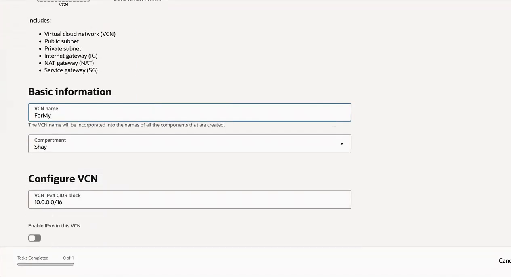
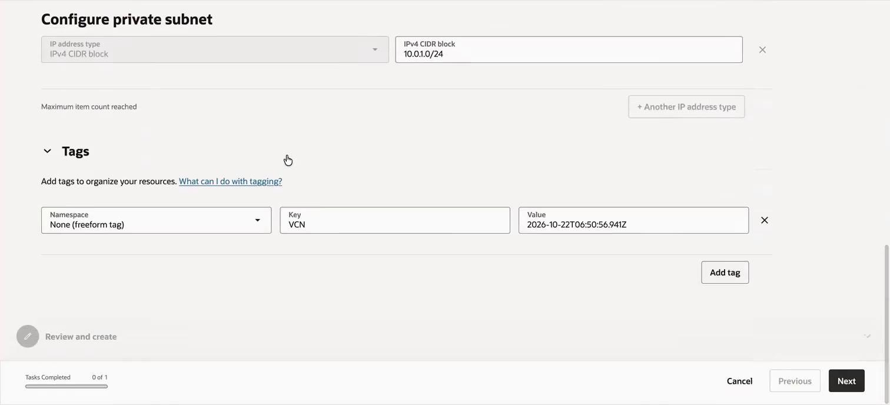
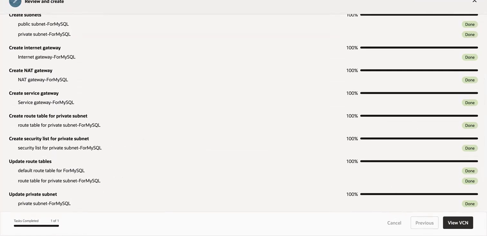
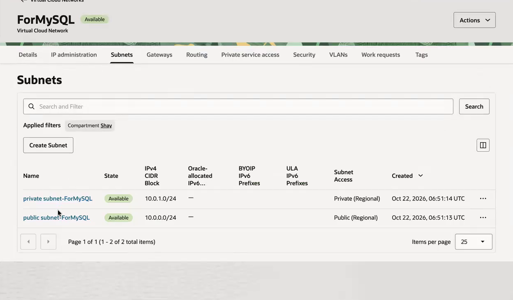

# Create a VCN with Public and Private Subnets

## Introduction

Create the network shown in the recording with the **VCN with internet connectivity** wizard.

Estimated Time: 15 minutes

### Objectives

- Select the workshop region and compartment.
- Create the VCN and nonoverlapping regional subnets.
- Confirm that the wizard completes.

### Prerequisites

Complete the prerequisites in the Introduction. Use a compartment designated for training.

## Task 1: Open the networking wizard

1. Sign in to the [OCI Console](https://cloud.oracle.com/). Select the region where you will run the workshop. The recording uses US East (Ashburn); use the region assigned to your training environment.

2. Open the navigation menu and select **Networking**, then **Virtual cloud networks**. Select your training compartment.

3. Select **Start VCN wizard**. If the button is inside **Actions**, open that menu first. Select **Create VCN with internet connectivity**, then start the wizard. You can also launch it from the Networking Overview page.

    Use the wizard rather than the standalone **Create VCN** form so that the subnets and gateways are created together.

## Task 2: Configure the network

1. Enter **ForMySQL** for the VCN name and select your training compartment. If that name is already in use for another exercise, use a unique suffix and substitute it in later steps.

2. Set the VCN IPv4 CIDR to **10.0.0.0/16**. Leave IPv6 disabled for this exercise.

    

    Video reference: 00:35. The captured name is still being typed; enter the complete name ForMySQL. Use your compartment instead of the example compartment.

3. Set the public subnet IPv4 CIDR to **10.0.0.0/24** and the private subnet IPv4 CIDR to **10.0.1.0/24**. Keep regional subnets and DNS hostnames enabled where offered.

    

    Video reference: 00:40. The two subnet ranges must sit within the VCN range and must not overlap each other.

4. Leave tags at their defaults unless your tenancy requires specific tags. The timestamp tag in the recording is not required for the exercise. Select **Next**.

## Task 3: Create and inspect the VCN

1. Review the VCN name, compartment, and all three CIDR blocks. Correct a mismatch before selecting **Create**.

2. Wait for the creation tasks to finish. Confirm that the wizard reports successful resource creation. If a task fails, inspect the error and check permissions and networking limits before retrying.

    

    Video reference: 01:00. Review the entire result list rather than only the first completed item.

3. Select **View VCN**. Open **Subnets** and verify the following values.

    | Subnet | IPv4 CIDR | Access | State |
    | --- | --- | --- | --- |
    | public subnet-ForMySQL | 10.0.0.0/24 | Public, regional | Available |
    | private subnet-ForMySQL | 10.0.1.0/24 | Private, regional | Available |

    

    Video reference: 01:10. Generated name capitalization can vary; identify each subnet by its CIDR and access type.

4. Record the VCN name, region, compartment, and subnet names. Continue to Lab 2.

## Learn More

- [VCN wizard options and generated resources](https://docs.oracle.com/en-us/iaas/Content/Network/Tasks/quickstartnetworking.htm)
- [Create a VCN for MySQL](https://docs.oracle.com/en-us/iaas/mysql-database/doc/creating-virtual-cloud-network.html)

## Acknowledgements

- **Author** - Shay Hameed, Cloud Engineer, Oracle
- **Last Updated By/Date:** Workshop adaptation, October 2026.
