# Deploy and Administer OLVM in Oracle Luna Labs


## Introduction

This optional lab is a complete OLVM administration workshop in a separate Oracle Luna Labs session. Allow 6-8 hours for the full lab. Labs 1-6 use the OCI E5 beginner environment; this lab starts again with Luna infrastructure and uses its own networking and access paths. Use the Luna lab link provided by your instructor or workshop owner. Completing Labs 1-6 does not create a Luna session.

Estimated Time: 6-8 hours

### Objectives

In this lab, you will:

- Provision the Luna environment and install the OLVM engine
- Configure two KVM hosts, logical networking, and shared storage
- Import templates and deploy the Employee Directory application VMs
- Perform VM live migration and storage live migration
- Back up the engine and review monitoring dashboards
- Create VM snapshots and manage users and roles

Oracle Virtualization provides KVM-based server virtualization with centralized management through Oracle Linux Virtualization Manager.

**Note:** This lab is available as a hands-on lab in [Oracle Luna Labs (luna.oracle.com)](https://luna.oracle.com). It is not searchable in Luna and is accessible only to users who have the direct lab link. The lab uses example values for hostnames, IP addresses, networks, and storage resources. When completing your lab, use the values generated in your own Luna session.

### Quick Start Summary

**What you will complete in 6-8 hours:**

- **Deploy OLVM Engine** - Install Oracle Linux Virtualization Manager on a dedicated host with Administration Portal access
- **Configure KVM Cluster** - Add two KVM hosts (`olkvm01`, `olkvm02`) with VDSM agents to form a high-availability cluster
- **Configure VM Networking** - Create the `l2-vm-network` logical network and assign it to both hosts
- **Configure Shared Storage** - Add a Fibre Channel storage domain for VM disks and templates
- **Import Oracle Linux Template** - Download and import an Oracle Linux 9 OVA template
- **Create Test VM** - Deploy `ol9-vm1` at `10.0.10.105` from the template to verify the infrastructure
- **Import Application VMs** - Import prebuilt OVA files to deploy `ol9-mysql` at `10.0.10.100` and `ol9-webapp` at `10.0.10.101`
- **Perform VM Live Migration** - Migrate a running VM between hosts with zero downtime
- **Perform Storage Live Migration** - Add a second Fibre Channel storage domain and move a running VM disk between storage domains
- **Back Up OLVM Engine** - Create a manual OLVM Engine backup and configure a scheduled backup script
- **Explore Monitoring Portal** - Access Grafana dashboards to review engine, host, VM, storage, and network behavior
- **Create VM Snapshot** - Create a VM snapshot as a point-in-time protection exercise
- **Manage Users and Roles** - Create Keycloak-backed and local internal users, import users into OLVM, and assign roles
- **Validate OLVM Administration Skills** - Gain hands-on experience with core and advanced OLVM administration tasks

**Core Lab Time:** 4–5 hours
**Advanced Lab Time:** 2–3 additional hours
**Total Estimated Time:** 6–8 hours, depending on your experience and troubleshooting time

**End Result:** A fully functional OLVM cluster running distributed VMs with an Employee Directory web application accessible at `http://10.0.10.101:8080/employee-app/employees`, plus advanced administration practice with storage migration, backup, monitoring, and snapshots.


### Lab Environment: Luna Sandbox Simulation for On-Premises OLVM

This hands-on lab runs in Oracle Luna Labs (luna.oracle.com). It simulates an on-premises OLVM deployment with dedicated KVM hosts, shared storage, and VM networking. It mirrors a typical data center virtualization setup. While provisioned on OCI infrastructure, the focus is on core OLVM administration tasks like engine installation, host clustering, VM management, networking, and storage.

**CRITICAL:** The Luna lab environment is temporary and expires after your session ends. You **MUST complete the lab in one sitting** or be prepared to restart from the beginning in a new session. Plan accordingly and ensure you have enough time available.

- **Key Benefits:** Safe, repeatable practice in a simulated data center environment; no need for your own hardware
- **Prerequisites:** Basic Linux familiarity; access to Luna Labs

### Lab Approach

This experience intentionally goes beyond a minimal "hello-world" tutorial. The design demonstrates how Oracle Virtualization is actually used-starting with environment setup, moving through core administration tasks, and validating the platform by running workloads. Students first build and validate the OLVM environment, execute a prebuilt multi-tier application using OVA imports, and then extend their skills with storage live migration, engine backup, monitoring, snapshots, and user/role management.


### Intended Audience

This lab is intended for:

- System administrators learning Oracle Linux Virtualization Manager
- DevOps engineers evaluating Oracle Virtualization
- Anyone who wants hands-on experience building and managing a KVM-based virtualization platform
- Learners seeking self-paced, practical exposure to OLVM


### Based on the Official Luna Lab

This lab extends the [**official "Install Oracle Linux Virtualization Manager in Oracle Cloud Infrastructure"**](https://docs.oracle.com/en/learn/olvm-install/index.html).


### Prerequisites

Before starting this lab, ensure you have:

- ✓ Access to Oracle Luna Labs (luna.oracle.com + Oracle account)
- ✓ A Chrome web browser with functioning copy/paste support
- ✓ Note-taking tool ready (you'll need to record IP addresses)
- ✓ Basic familiarity with Linux command line
- ✓ Understanding of SSH and terminal usage
- ✓ No Java or application development experience required (Task 4 uses prebuilt OVA files)

### SSH Connection Reference

Throughout this lab, you'll need to connect to different systems. Use this reference to understand the connection paths.

### Network Architecture

```
┌─────────────────────────────────────────────────────────────────────────┐
│                         Connection Paths                                │
│                                                                         │
│  ┌──────────────┐      ┌──────────────┐      ┌──────────────────────┐   │
│  │ Luna Desktop │ SSH  │    olvm      │ SSH  │   Virtual Machines   │   │
│  │ (VNC Viewer) │ ───> │   (Engine)   │ ───> │                      │   │
│  └──────────────┘      └──────────────┘      │  • ol9-mysql         │   │
│                              │               │    (10.0.10.100)     │   │
│                              │ SSH           │                      │   │
│                              ▼               │  • ol9-webapp        │   │
│                        ┌──────────────┐      │    (10.0.10.101)     │   │
│                        │ KVM Hosts    │      └──────────────────────┘   │
│                        │ • olkvm01    │                                 │
│                        │ • olkvm02    │                                 │
│                        └──────────────┘                                 │
└─────────────────────────────────────────────────────────────────────────┘
```


| From | To | Command |
|------|-----|---------|
| olvm | ol9-mysql | `ssh opc@10.0.10.100` |
| olvm | ol9-webapp | `ssh opc@10.0.10.101` |
| olvm | KVM hosts | `ssh olkvm01` or `ssh olkvm02` |

**Note:** KVM hosts use pre-configured SSH keys and hostnames. VMs require username, IP, and password for SSH login.


## Task 1: Infrastructure Setup

#### Overview

In this part, you will provision the lab environment and install the Oracle Linux Virtualization Manager engine. This establishes the foundation for your virtualization platform.


#### Learning Objectives
- Deploy lab infrastructure using Ansible
- Install and configure the OLVM engine using `engine-setup`
- Access the Administration Portal

#### What You Will Build

```
┌─────────────────────────────────────────────────────────────────────────┐
│  Part 1: Infrastructure Setup                                           │
│                                                                         │
│  ┌─────────────────┐                                                    │
│  │   OLVM Engine   │                                                    │
│  │     (olvm)      │                                                    │
│  │                 │                                                    │
│  │ • Admin Portal  │                                                    │
│  │ • REST API      │                                                    │
│  │ • PostgreSQL    │                                                    │
│  └─────────────────┘                                                    │
│                                                                         │
│  olkvm01 and olkvm02 hosts provisioned but not yet configured           │
└─────────────────────────────────────────────────────────────────────────┘
```

#### Estimated Time

30-45 minutes

#### Steps

1. Launch the OLVM lab in Luna Labs
1. Deploy the lab environment using Ansible (provisions olvm, olkvm01, olkvm02)
1. Record IP addresses for all hosts
1. Open a VNC session to the OLVM Manager
1. Install the Oracle Linux Virtualization Manager Engine
1. Log in to the Administration Portal

#### Validation Checklist

Before continuing to Task 2, confirm:

- ✓ Ansible playbook completed - olvm, olkvm01, olkvm02 provisioned
- ✓ Public and private IP addresses recorded for all three hosts
- ✓ AMD-V / VMX virtualization verified on both KVM hosts
- ✓ VNC session open to the OLVM engine desktop
- ✓ OLVM engine installed via `engine-setup` without errors
- ✓ Administration Portal accessible at `https://<olvm-fqdn>/ovirt-engine`
- ✓ Logged in successfully as `admin@ovirt`


### Deploy Oracle Virtualization

> **Quick Tip:** Mac users use Command+C/Command+V for copy/paste, or two-finger click for right-click. Windows and Linux users, your usual Ctrl+C/Ctrl+V shortcuts work.
>

1. Open a terminal from the Luna Desktop. Click the Applications menu in the bottom-left corner and select Terminal Emulator.

    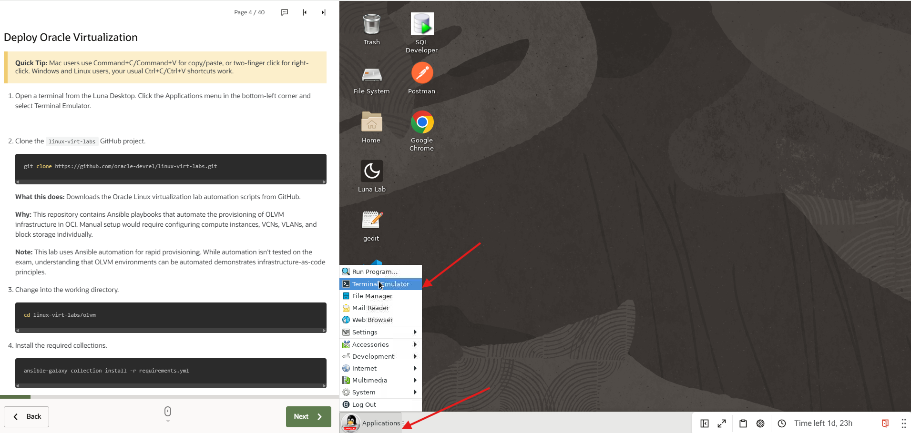

1. Clone the `linux-virt-labs` GitHub project.

    ```bash
    git clone https://github.com/oracle-devrel/linux-virt-labs.git
    ```

    **What this does:** Downloads the Oracle Linux virtualization lab automation scripts from GitHub.

    **Why:** This repository contains Ansible playbooks that automate the provisioning of OLVM infrastructure in OCI. Manual setup would require configuring compute instances, VCNs, VLANs, and block storage individually.

    **Note:** This lab uses Ansible automation for rapid provisioning. While automation isn't tested on the exam, understanding that OLVM environments can be automated demonstrates infrastructure-as-code principles.

1. Change into the working directory.

    ```bash
    cd linux-virt-labs/olvm
    ```

1. Replace the repository's build.yml file with the updated version to fix an OCI compatibility issue (IMDSv2/IMDSv1) that can prevent the lab servers from being created.

    ```bash
    curl -fL "https://objectstorage.us-ashburn-1.oraclecloud.com/n/idhwewbjlvpy/b/linux-virt-labs-git-repo/o/build.yml" -o build.yml
    ```

1. Install the required collections.

    ```bash
    ansible-galaxy collection install -r requirements.yml
    ```

    **What this does:** Installs required Ansible collections (reusable automation modules) specified in requirements.yml.

    **Why:** The playbooks depend on Oracle Cloud Infrastructure (OCI) and community collections to interact with OCI APIs for creating compute instances, networking, and storage.

    **Collections installed:**
    - `oracle.oci` - OCI resource management
    - `community.general` - General-purpose automation tasks

1. Update the Oracle Linux instance configuration.

    ```bash
    cat << EOF | tee instances.yml > /dev/null
    compute_instances:
     1:
       instance_name: "olvm"
       type: "engine"
       instance_ocpus: 2
       instance_memory: 32
     2:
       instance_name: "olkvm01"
       type: "kvm"
       instance_ocpus: 8
       instance_memory: 64
     3:
       instance_name: "olkvm02"
       type: "kvm"
       instance_ocpus: 8
       instance_memory: 64
    use_vnc_on_engine: true
    EOF
    ```

    **What this configures:**
    - **olvm**: Manager/Engine node (2 OCPUs, 32GB RAM) - runs the oVirt Engine management software
    - **olkvm01 & olkvm02**: KVM host nodes (8 OCPUs, 64GB RAM each) - run virtual machines using KVM hypervisor
    - **use_vnc_on_engine**: Enables VNC server on the engine for remote desktop access

    **Why these specs:**
    - Engine needs moderate resources for the PostgreSQL database and management services
    - KVM hosts need more resources to run multiple VMs with good performance
    - 2 KVM hosts provide high availability (HA) for self-hosted engine deployments

    **Architecture note:** In production, the engine often runs as a "self-hosted engine" (inside a VM on the KVM hosts), but for this lab, it runs on dedicated infrastructure for simplicity.


1. Create an inventory file.

    ```bash
    cat << EOF | tee hosts > /dev/null
    localhost ansible_connection=local ansible_connection=local ansible_python_interpreter=/usr/bin/python3.6
    EOF
    ```

    **What this does:** Creates an Ansible inventory file that tells Ansible to run the playbook locally on the Luna desktop using Python 3.6.

    **Why:** The playbook runs from the Luna environment and uses OCI APIs to provision the OLVM lab resources, including the `olvm`, `olkvm01`, and `olkvm02` instances.

1. Deploy the lab environment.

    ```bash
    ansible-playbook create_instance.yml -i hosts -e "@instances.yml"
    ```

    **What this does:** Provisions the lab infrastructure in OCI - creates 3 compute instances (olvm, olkvm01, olkvm02), configures networking, and attaches storage.

    **Important:** The playbook will pause after completing deployment to keep your environment running. **DO NOT hit `enter` to continue Instead hit  `ctrl-c` then `a` to abort!!!**.


    > **⚠️ CRITICAL:** When the playbook pauses, it displays **both public and private IP addresses** for each instance:
    >
    > - **olvm**
    >   - Public IP (used for SSH access and VNC tunneling)
    >   - Private IP (used for internal OLVM communication)
    >
    > - **olkvm01**
    >   - Public IP (SSH access if needed)
    >   - Private IP (VDSM, storage, VM networking)
    >
    > - **olkvm02**
    >   - Public IP (SSH access if needed)
    >   - Private IP (VDSM, storage, VM networking)
    >
    > **Required Actions:**

    > - **Do not press Enter when the playbook pauses.**
    > - **Press `Ctrl+C`, then type `A` to abort and preserve the deployed servers.**
    > - **Pressing Enter continues cleanup and deletes the lab environment.**
    > - **Record both public and private IPs for all instances.**

    > **Why this matters:**

    > - OLVM uses **private IPs** for engine ↔ host (VDSM) communication
    > - SSH access may use **public or private IPs**, depending on context
    > - Later steps assume you understand which IP type is being used
    >
    > **⚠️ Important: Verify Virtualization Support Before Proceeding (follow your instructor's guidance).**

1. From the same Luna Desktop terminal clear the screen.

    ```bash
    clear
    ```

1. Verify olkvm01 (replace `<ip_of_olkvm01>` with the IP address from the previous step output).

    ```bash
    ssh oracle@<ip_of_olkvm01> 'grep -E "svm|vmx" /proc/cpuinfo > /dev/null && echo "AMD-V ENABLED - Good to go!" || echo "AMD-V NOT FOUND - Please raise your hand"'
    ```

1. Verify olkvm02 (replace `<ip_of_olkvm02>` with the IP address from the previous step output).

    ```bash
    ssh oracle@<ip_of_olkvm02> 'grep -E "svm|vmx" /proc/cpuinfo > /dev/null && echo "AMD-V ENABLED - Good to go!" || echo "AMD-V NOT FOUND - Please raise your hand"'
    ```

    > **Expected output:** `AMD-V ENABLED - Good to go!`
    > **If you see:** `AMD-V NOT FOUND - Please raise your hand` - **stop and wait for your instructor before continuing.**


### Oracle Virtualization - The big picture

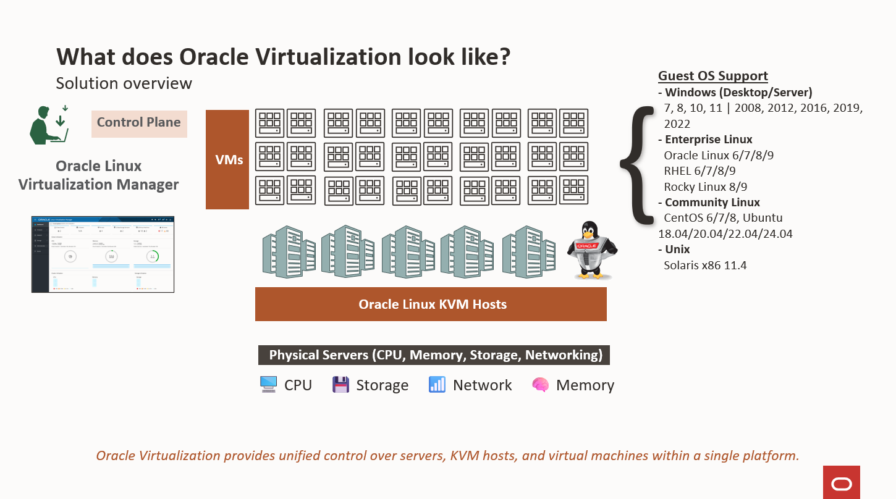

#### WHAT DOES ORACLE VIRTUALIZATION LOOK LIKE? - The complete platform, from control plane to infrastructure

##### Platform layers:
- Physical Servers - The foundation. Provide CPU, memory, storage, and networking.
- Oracle Linux KVM Hosts - The middle layer. Run multiple virtual machines with different guest operating systems, including Linux and Windows.
- Oracle Linux Virtualization Manager (OLVM) - The centralized control plane. Logically separated from the KVM hosts and the VMs they run.

> **Note**: This separation is intentional - it improves reliability and scalability, and simplifies management across many hosts. The control plane (OLVM) focuses on centralized management from one place. KVM hosts focus on workload execution using KVM in the Linux kernel.

> **Key concept - User Space vs Kernel Space:** Linux divides memory into two areas. **Kernel space** is the memory area where the operating system core and hardware drivers run - it has direct access to hardware. **User space** is the memory area where applications run - they must request hardware access through the kernel. In OLVM, KVM runs in kernel space for near-native performance, while each VM runs as a QEMU (Quick Emulator) process in user space. You'll see this distinction in the architecture stack next.

### Architecture Overview

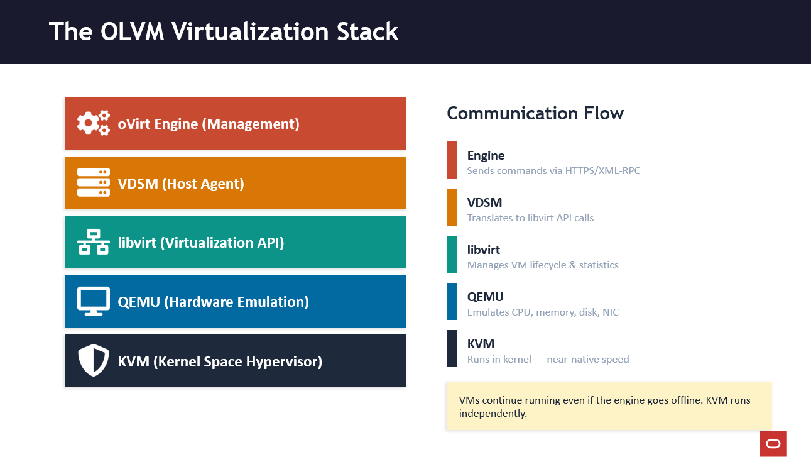


##### THE VIRTUALIZATION STACK - This is the most important diagram in the lab

##### Walk through from top to bottom:
- oVirt ENGINE - The brain. Java app on WildFly server (formerly JBoss) + PostgreSQL. Sends commands down.
- VDSM - Virtual Desktop and Server Manager. Daemon on EVERY KVM host. The agent.
- libvirt - The API layer. VDSM talks to libvirt, not directly to KVM.
- QEMU - Quick Emulator. Emulates hardware (CPU, memory, disk, NIC) for each VM. Each VM is a QEMU process in USER SPACE.
- KVM - The actual hypervisor. Runs in KERNEL SPACE. Provides near-native performance.

> **Note**: If the engine goes offline, VMs keep running! The engine is management only. KVM handles execution independently.


### Architecture Quick Review

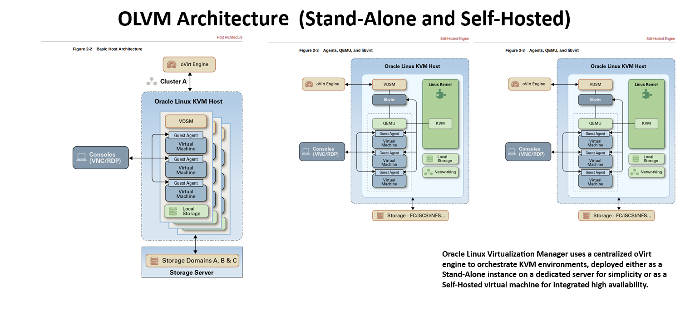

#### Three deployment sizes

The following table describes recommended sizing for the OLVM engine based on the number of hosts and VMs managed.

| | Small | Medium | Large |
|---|---|---|---|
| **Hosts** | 1–5 | 5–50 | 50–200 |
| **VMs** | Up to 50 | 50–500 | 500–2,000 |
| **CPU (recommended)** | 4 cores | 8 cores | 16 cores |
| **RAM (recommended)** | 16 GB | 32 GB | 64 GB |
| **Disk (recommended)** | 50 GB | 100 GB | 200 GB |
| **CPU (minimum)** | 2 cores | - | - |
| **RAM (minimum - Standalone)** | 4 GB | - | - |
| **RAM (minimum - Self-Hosted Engine)** | 16 GB | - | - |
| **Disk (minimum)** | 25 GB | - | - |
| **Deployment Types** | Standalone & Self-Hosted Engine | Standalone & Self-Hosted Engine | Standalone & Self-Hosted Engine |

> **Note** - Minimum values are provided only for Small deployments; Medium and Large deployments should follow recommended values.


### Open a VNC Session to the Manager

1. Open a new terminal and connect to the olvm instance via SSH.

    The `-L` option enables local forwarding, which opens a local port to connect through an SSH tunnel to the remote VNC server.
    ```bash
    ssh -L 5914:localhost:5901 oracle@<ip_address_of_instance>
    ```
    **What this does:** Creates an SSH tunnel that forwards local port 5914 to the remote VNC server on port 5901.

    **How SSH tunneling works:**
      - Your local machine (for this lab LUNA sandbox) listens on port 5914
      - Traffic sent to localhost:5914 gets encrypted and sent through SSH
      - SSH server forwards it to localhost:5901 on the remote machine
      - VNC server on remote machine responds back through the tunnel


    **Three-Tier Architecture:**
    ```
    ┌─────────────────┐         ┌─────────────────┐         ┌─────────────────┐
    │   YOUR COMPUTER │         │  LUNA SANDBOX   │         │  OLVM MANAGER   │
    │   (Your laptop) │────────>│   (Desktop)     │────────>│   (Remote VM)   │
    │                 │         │                 │         │                 │
    │  Web Browser    │         │  VNC Viewer     │         │  VNC Server     │
    │  (HTML5)        │         │  localhost:5914 │         │  localhost:5901 │
    └─────────────────┘         └─────────────────┘         └─────────────────┘
      Internet                    SSH Tunnel                  On Manager
    ```

      **Data Flow:**
      1. You access Luna via browser (https://luna.oracle.com)
      1. Luna runs: `ssh -L 5914:localhost:5901 oracle@<olvm-public-ip>`
      1. TigerVNC on Luna connects to localhost:5914
      1. Traffic tunnels through SSH to OLVM Manager port 5901
      1. You see OLVM Manager desktop and configure the system

      **Command breakdown:**
    ```
      ssh -L 5914:localhost:5901 oracle@<olvm-public-ip>
    ```

    This command means:
    - `-L 5914:localhost:5901` - "Create a local port forwarding tunnel"
    - `5914` - Listen on port 5914 on **my local** computer
    - `localhost:5901` - Port 5901 on the **remote server's** localhost (where VNC is running)
    - `oracle@<manager-ip>` - Connect via SSH to the remote server


    **Why:** VNC port 5901 is not directly accessible from the internet (firewalled). SSH tunneling provides secure, encrypted access.

    **Note:** SSH tunneling is a general Linux system administration skill. OLVM uses VNC ports 5900-6923 (extended beyond standard 5900-5999)


1. Switch to the Luna Desktop.

1. Open the TigerVNC Viewer by clicking the Applications menu, Internet, and then TigerVNC Viewer.

    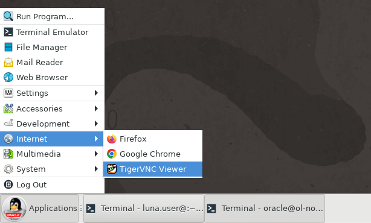


1. Log on to the deployed server's GUI environment by entering `localhost:5914` into the VNC Server text box and pressing the Connect button.

    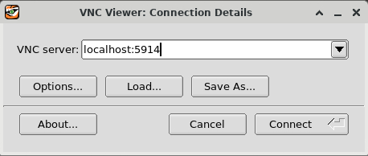

1. Enter the `oracle` user's password of oracle and press the OK button.

    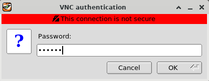

1. The Server's GUI desktop is displayed with a first-time login setup.

    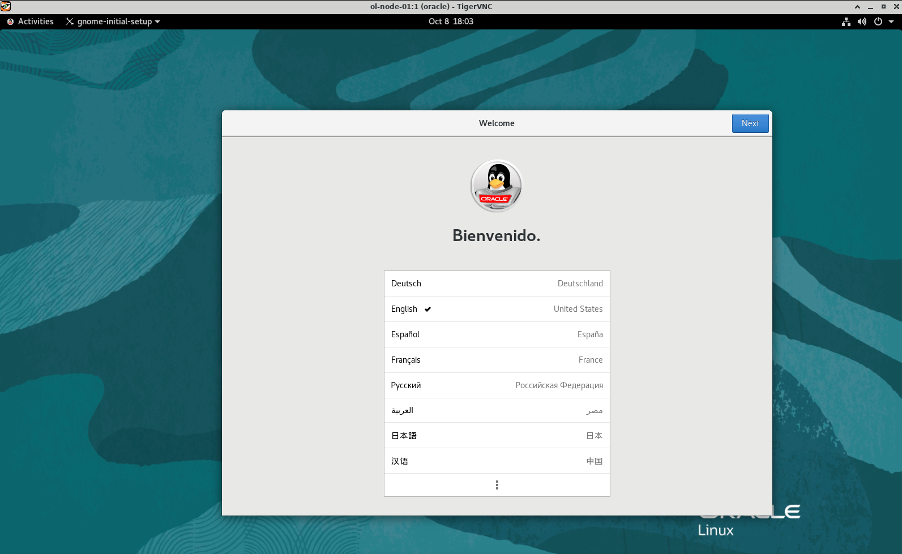

1. Press the Next button three times, then the Skip button, followed by the Start Using Oracle Linux Server button. Finally, close or minimize the Getting Started window.

    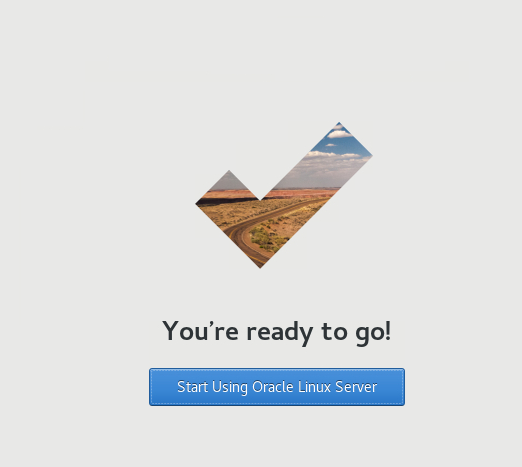


### Install the Engine

1. Open the VNC Activities Menu.

    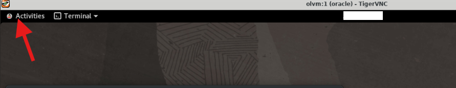

1. Open a terminal within the VNC session.

    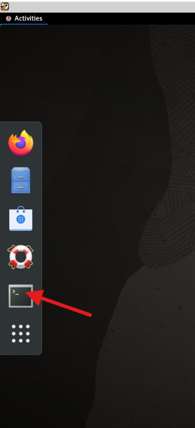

1. Enable copy and paste to the VNC session.
    ```bash
    vncconfig -nowin &
    ```

1. Install the Oracle Linux Virtualization Manager Release package, which automatically enables/disables the required repositories.

    ```bash
    sudo dnf install -y oracle-ovirt-release-45-el8
    ```

    **What this does:** Installs the OLVM repository configuration package for release 4.5 on Oracle Linux 8.

    **Why:** This package automatically enables/disables the required YUM/DNF repositories needed for OLVM installation. Without it, you'd have to manually configure each repository URL, GPG keys, and priorities.

    **Repositories required for this lab:**
    - `ol8_baseos_latest` - Core Oracle Linux 8 operating system packages, including foundational system libraries, command-line tools, and base platform components.
    - `ol8_appstream` - Application Stream packages for Oracle Linux 8, including user-space applications, runtimes, developer tools, and supporting software.
    - `ol8_kvm_appstream` - KVM virtualization packages for Oracle Linux 8, including QEMU, libvirt, and related virtualization components required by OLVM hosts.
    - `ol8_addons` - Additional Oracle Linux 8 packages that extend the base operating system and support related platform features used by OLVM.
    - `ovirt-4.5` - Core OLVM/oVirt 4.5 packages, including the engine, VDSM, and main virtualization management components.
    - `ovirt-4.5-extra` - Additional OLVM/oVirt 4.5 packages and supporting components that complement the core OLVM installation.
    - `ol8_gluster_appstream` - GlusterFS packages for Oracle Linux 8, used for distributed storage scenarios and storage-related dependencies.
    - `ol8_UEKR7` - Unbreakable Enterprise Kernel Release 7 packages for Oracle Linux 8, including the Oracle-supported kernel used for virtualization workloads.

    **Version note:** The package name oracle-ovirt-release-45-el8 encodes two version numbers. 45 refers to OLVM 4.5, which is Oracle's supported distribution of the open-source oVirt 4.5 project. el8 means Enterprise Linux 8, indicating the package is built and tested for Oracle Linux 8. Always verify that both numbers match your environment - installing a package built for a different OS version could cause dependency conflicts or unsupported configurations.


1. Clear the dnf cache.

    ```bash
    sudo dnf clean all
    ```
    **What this does:**
    1. clean dbcache: Removes the metadata database.
    1. clean expire-cache: Forces a check for new repository data.
    1. clean metadata: Removes XML files used to find packages.
    1. clean packages: Removes any cached .rpm files currently in the system.


1. List the configured repositories and verify that the required repositories are enabled.

    ```bash
    sudo dnf repolist
    ```
1. **Repositories required for this lab:**

    - `ol8_baseos_latest`
    - `ol8_appstream`
    - `ol8_kvm_appstream`
    - `ol8_addons`
    - `ovirt-4.5`
    - `ovirt-4.5-extra`
    - `ol8_gluster_appstream`
    - `ol8_UEKR7`

    If a required repository is not enabled, use the `dnf config-manager` command to enable it.

    ```bash
    sudo dnf config-manager --enable <repository_name>
    ```

1. Install the Manager package.

    ```bash
    sudo dnf install -y ovirt-engine
    ```

    **What this does:** Downloads and installs the core Oracle Linux Virtualization Manager software and required dependencies, including Java and application server components.

    **Why:** This places the OLVM Engine software on the system. It does not fully configure the Manager. Configuration happens in the next step when you run `engine-setup`.

1. Configure the Manager.

    ```bash
    sudo engine-setup --accept-defaults
    ```
    **What this does:** Runs the OLVM Engine configuration wizard with all default answers accepted automatically.

    **Behind the scenes, engine-setup:**
    - **Configures PostgreSQL database** - Creates ovirt_engine database, sets up users and permissions
    - **Configures Apache and WildFly** - Sets up the web and application server components for the Administration Portal and REST API
    - **Generates SSL certificates** - Creates CA and host certificates for secure communications
    - **Configures firewall** - Opens required ports (443 for HTTPS, 5432 for PostgreSQL)
    - **Creates admin user** - Sets up admin@ovirt user in the internal authentication domain
    - **Initializes oVirt Engine** - Deploys the engine web application and starts services
    - **Creates default data center and cluster** - Named "Default" by default

    **Without --accept-defaults:** The wizard would prompt you for each configuration option, including:
    - Installation type (standalone vs self-hosted)
    - Firewall configuration
    - Database connection details
    - PKI configuration
    - Network settings

    **Time:** Takes 5-10 minutes to complete all configuration steps.

    **Output files:**
    - Configuration stored in: `/etc/ovirt-engine/`
    - Logs available at: `/var/log/ovirt-engine/setup/`
    - Answer file saved for future reference: `/var/lib/ovirt-engine/setup/answers/`

    **Admin password:** The wizard will prompt for admin@ovirt password even with --accept-defaults. This is the only interactive prompt. Password must be 8+ characters with uppercase, lowercase, number, and special character.

    >**CRITICAL:** When engine-setup completes, WRITE DOWN the admin password!


### Management Portals Review

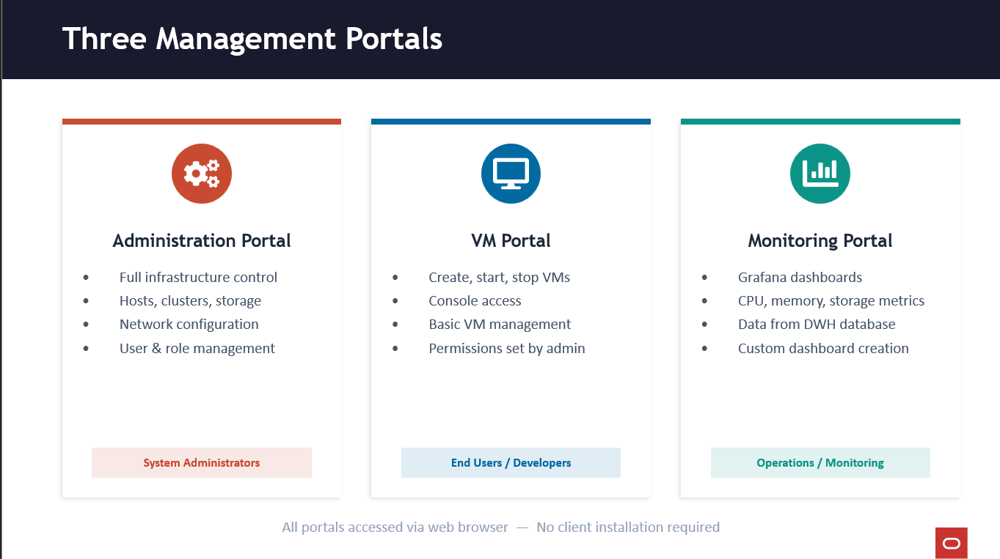

##### THREE MANAGEMENT PORTALS - All web-based, no client installation.

1. ADMINISTRATION PORTAL (what you'll use in the lab):
    - The 'nerve center' - full control over everything
    - Hosts, clusters, storage domains, networks, VMs, users
    - You log in as admin@ovirt in Task 1 of the lab

1. VM PORTAL:
    - Simplified interface for end users
    - Create/start/stop VMs, console access via VNC or RDP
    - Capabilities controlled by the admin (role-based)
    - Console protocols: VNC and RDP

1. MONITORING PORTAL (Grafana):
    - Integrated Grafana dashboards
    - Pulls data from ovirt_engine_history database (Data Warehouse)
    - CPU, memory, storage, network metrics
    - Grafana runs on port 3000


### Login to the Administration Portal

1. Get the FQDN for the manager host.

    ```bash
    hostname -f
    ```
    **What this does:** Displays the Fully Qualified Domain Name (FQDN) of the host.

    **Example output:** `olvm.examplevcn.oraclevcn.com`

    **Why FQDN matters:**
    - The engine's SSL certificate is bound to the FQDN
    - You must access the web interface using the FQDN in the URL

    **What is FQDN:** hostname + domain name
    - Hostname: `olvm`
    - Domain: `examplevcn.oraclevcn.com`
    - FQDN: `olvm.examplevcn.oraclevcn.com`

1. Open the VNC Activities Menu.

    

1. Open Firefox within the VNC session.

    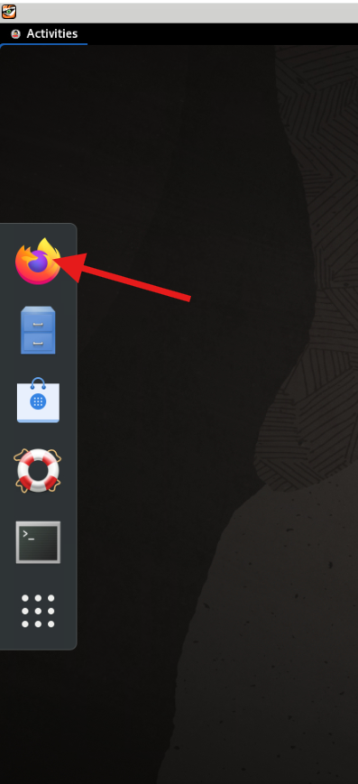

1. Enter the following link to access the engine's Web UI for this lab.
    ```
    https://olvm.pub.olv.oraclevcn.com
    ```

    **Security Warning:** Firefox will display "Warning: Potential Security Risk Ahead" because the OLVM engine uses a self-signed SSL certificate. This is expected and safe in this lab environment.

    To proceed:
    1. Click the `Advanced` button
    1. Click `Accept the Risk and Continue`


    The Welcome page displays.

    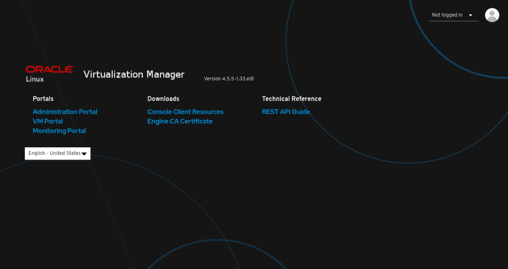

1. Under Downloads, click Engine CA Certificate.

    The `pki-resource` certificate file downloads to the browser's downloads folder on the file system.

1. Import the certificate into the browser.

    1. Open the browser menu and click Settings.
    1. Use the search and enter `cert`.
    1. Click the View Certificates… button.

      The Certificate Manager dialog box opens.

    1. Click the Import… button.

      The Select File containing CA certificates(s) to import dialog box opens.

    1. From the Certificate Files drop-down list, select All Files.
    1. Click the `pki-resource` file from the file selection panel.
    1. Click the Open button.

      The Download Certificate dialog box opens.

    1. Click the check box next to Trust this CA to identify websites., and click OK.
    1. Click OK.
    1. Close the browser Settings tab.

1. From the engine's Web UI, click Administration Portal.

    The Login page displays.

1. Enter `admin@ovirt` for the Username and the password you specified when configuring the Manager.

1. The Administration Portal displays after a successful login.

    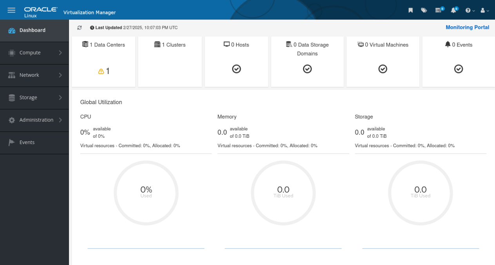


## Task 2: KVM Host

#### Overview

#### KVM Host Architecture - Key Components

```
┌─────────────────────────────────────────┐
│              ENGINE HOST                │
│         (oVirt Engine / WildFly)        │
│    Communicates with VDSM on hosts      │
└──────────────┬──────────────────────────┘
               │
    ┌──────────▼──────────────────────────┐
    │           KVM HOST                  │
    │                                     │
    │  ┌─────────┐  ┌──────────────────┐  │
    │  │  VDSM   │  │   libvirtd       │  │
    │  │ (host   │──│  (manages VM     │  │
    │  │  agent) │  │   lifecycle)     │  │
    │  └─────────┘  └───────┬──────────┘  │
    │                       │             │
    │  ┌────────────────────▼──────────┐  │
    │  │         KVM Module            │  │
    │  │      (kernel space)           │  │
    │  └───────────┬───────────────────┘  │
    │              │                      │
    │  ┌───────────▼───────────────────┐  │
    │  │     QEMU Processes            │  │
    │  │    (user space - one per VM)  │  │
    │  │  ┌─────┐ ┌─────┐ ┌─────┐      │  │
    │  │  │ VM1 │ │ VM2 │ │ VM3 │      │  │
    │  │  │guest│ │guest│ │guest│      │  │
    │  │  │agent│ │agent│ │agent│      │  │
    │  │  └─────┘ └─────┘ └─────┘      │  │
    │  └───────────────────────────────┘  │
    └─────────────────────────────────────┘
```

| Component | Where it Runs | Role |
|-----------|--------------|------|
| **KVM** | Kernel space (loadable kernel module) | Full virtualization using hardware extensions; shares physical hardware with VMs |
| **QEMU** | User space (one process per VM) | Emulates hardware (CPU, memory, network, disk); executes VM code directly on host CPU |
| **VDSM** | KVM host (daemon) | Host agent; intermediary between engine and host; manages VMs, networks, storage |
| **libvirtd** | KVM host (service) | API layer for managing hypervisors; VDSM uses libvirt to manage VM lifecycle and collect stats |
| **Guest Agent** | Inside each VM | Communicates with engine over virtualized serial connection; reports machine name, OS details, IP addresses, installed apps, network/RAM usage |

#### Critical Relationships
- Engine → talks to → VDSM (on each host)
- VDSM → uses → libvirt → manages → KVM/QEMU
- Guest Agent → communicates over → virtualized serial connection → to engine
- KVM runs in kernel space; VMs run as QEMU processes in user space


#### What you will build

In this part, you will add KVM hosts to your cluster and verify their integration with the OLVM engine. These hosts will run your virtual machines.

#### Learning Objectives
- Configure KVM host prerequisites
- Add hosts to the Default cluster
- Verify VDSM agent functionality


```
┌─────────────────────────────────────────────────────────────────────────┐
│                     Part 2: Host Configuration                          │
│                                                                         │
│  ┌─────────────────┐      ┌─────────────────┐   ┌─────────────────┐     │
│  │   OLVM Engine   │      │    olkvm01      │   │    olkvm02      │     │
│  │     (olvm)      │      │   (KVM Host)    │   │   (KVM Host)    │     │
│  │                 │      │                 │   │                 │     │
│  │ • Admin Portal  │ ───> │ • VDSM Agent    │   │ • VDSM Agent    │     │
│  │ • REST API      │      │ • libvirt/KVM   │   │ • libvirt/KVM   │     │
│  │ • PostgreSQL    │      │ • Status: Up    │   │ • Status: Up    │     │
│  └─────────────────┘      └─────────────────┘   └─────────────────┘     │
│                                                                         │
│  Hosts added to Default cluster; Ready for VMs                          │
└─────────────────────────────────────────────────────────────────────────┘
```

#### Estimated Time
30-45 minutes

#### Steps

1. Configure the first KVM host (olkvm01)
1. Add the first KVM host to the cluster
1. Configure the second KVM host (olkvm02)
1. Add the second KVM host to the cluster

#### Validation Checklist

Before continuing to Task 3, confirm:

- ✓ `oracle-ovirt-release-45-el8` installed on both olkvm01 and olkvm02
- ✓ `kernel-uek-modules-extra` installed and both hosts rebooted
- ✓ Required repositories enabled on both hosts (`dnf repolist`)
- ✓ `olvm-pre-check.py` completed without failures on both hosts
- ✓ SSH public key copied from engine to both hosts
- ✓ olkvm01 status shows **Up** in the Administration Portal
- ✓ olkvm02 status shows **Up** in the Administration Portal

### Configure the First KVM Host (olkvm01)

1. Open the VNC Activities Menu.

    

1. Switch to the terminal within the VNC session.

1. Connect via SSH to the olkvm01 instance.

    ```bash
    ssh olkvm01
    ```
    > **Context:** All SSH commands using hostnames (e.g., `ssh olkvm01`) are executed **from the OLVM engine**, which has private DNS resolution for the cluster hosts.

1. Install the Oracle Linux Virtualization Manager Release package, which automatically enables/disables the required repositories.

    ```bash
    sudo dnf install -y oracle-ovirt-release-45-el8
    ```
    **What this does:** Installs the OLVM repository configuration package for release 4.5 on Oracle Linux 8.

    **Why:** This package enables the required OLVM/oVirt, KVM, Gluster, and UEK repositories needed for the KVM host installation. These repositories allow the OLVM engine to install VDSM, libvirt, QEMU/KVM, and other host-side virtualization components when the host is added to the cluster.


1. Clear the dnf cache.

    ```bash
    sudo dnf clean all
    ```

1. List the configured repositories and verify that the required repositories are enabled.

    ```bash
    sudo dnf repolist
    ```


1. **Repositories required for this lab:**

    - `ol8_baseos_latest`
    - `ol8_appstream`
    - `ol8_kvm_appstream`
    - `ol8_addons`
    - `ovirt-4.5`
    - `ovirt-4.5-extra`
    - `ol8_gluster_appstream`
    - `ol8_UEKR7`

    If a required repository is not enabled, use the `dnf config-manager` command to enable it.

    ```bash
    sudo dnf config-manager --enable <repository_name>
    ```

1. Exit the session.

    ```bash
    exit
    ```

    You should now be on the Manager host.


### Add KVM Host (olkvm01)
1. Open the VNC Activities Menu.

    

1. Switch to the Firefox browser within the VNC session.

1. Log in to the Administration Portal.

1. Using the side navigation menu, go to Compute and click Hosts.

1. On the Hosts pane, click the New button.

1. The New Host dialog box opens with the General tab selected on the sidebar.

1. Select the Default data center from the Host Cluster drop-down list.

    Installing Oracle Linux Virtualization Manager creates a data center and cluster named Default.

    **OLVM hierarchy explained:**

    ```
    Data Center (physical location)
      ↓
    Cluster (group of hosts with same CPU type)
      ↓
    Hosts (physical servers running KVM)
      ↓
    Virtual Machines
    ```

    **Data Center:**
    - Logical container for clusters
    - Defines shared storage and networking
    - Typically represents a physical location or administrative boundary
    - VMs can't migrate between data centers

    **Cluster:**
    - Group of hosts that share same:
     - CPU type (Intel or AMD, same generation for live migration)
     - Storage domains
     - Network configuration
    - Enables VM live migration between hosts in the cluster
    - Provides high availability (HA) for VMs
    - Requires at least 2 hosts for HA features

    **Why this hierarchy:**
    - **CPU compatibility** - VMs can only migrate between hosts with compatible CPUs
    - **Resource pooling** - Cluster shares resources for load balancing
    - **HA and migration** - Automatic VM restart/migration on host failure

    **Default setup:** engine-setup creates "Default" data center with "Default" cluster - you can rename or create new ones.

1. Enter a name for the host in the Name field.

    ```
    olkvm01
    ```

1. In the Hostname field, enter the fully-qualified domain name or IP address of the host.

    ```
    vdsm01.priv.olv.oraclevcn.com
    ```

    This entry is the fully-qualified name of the secondary VNIC attached to the KVM host.

    **Where did the Hostname come from?**
    >The Luna lab automation creates DNS names for the private VDSM management interfaces on the KVM hosts. In this lab, `olkvm01` has a secondary private VNIC named `vdsm01.priv.olv.oraclevcn.com`, and `olkvm02` has a secondary private VNIC named `vdsm02.priv.olv.oraclevcn.com`. These names are used by OLVM so engine-to-host communication, migration traffic, and storage-related traffic use the private network.

    **Why use VNIC hostname (vdsm01.priv...):**

    In this lab, the KVM host has **two network interfaces (VNICs)**:

    1. **Primary VNIC (ens3)** - Public subnet
      - For SSH access from outside
      - For external connectivity
      - Hostname: `olkvm01.examplevcn.oraclevcn.com`

    1. **Secondary VNIC (ens5)** - Private subnet
      - For OLVM management traffic (engine ↔ VDSM)
      - For VM migration
      - For storage traffic
      - Hostname: `vdsm01.priv.olv.oraclevcn.com`

    **Why separate management network:**
    - **Security** - Isolates management traffic from public internet
    - **Performance** - Dedicated bandwidth for VM migrations and storage
    - **Best practice** - Production deployments always separate management and VM networks

    **What VDSM listens on:** When you add the host using the secondary VNIC hostname, VDSM binds to that interface for all engine communications.

    **Real physical server note:**
    > In this Luna lab, `vdsm01.priv.olv.oraclevcn.com` is the DNS name for the secondary OCI VNIC used for private VDSM management traffic. On real physical servers, there is no OCI VNIC. Instead, use the FQDN or IP address of the physical NIC, bond, or VLAN interface that the OLVM engine should use to manage the KVM host. For example, a production host might use `kvm01-mgmt.example.com`, which resolves to the host’s management network IP.

1. Under Authentication, select the SSH Public Key authentication method.

    This action displays the engine's SSH public key within the SSH PublicKey field.

1. Open the VNC Activities Menu.

    

1. Switch to the terminal within the VNC session.


1. From the OLVM engine terminal: Copy the SSH public key to the `/root/.ssh/authorized_keys` file on the KVM host.

    ```bash
    sudo ssh-keygen -y -f /etc/pki/ovirt-engine/keys/engine_id_rsa | ssh olkvm01 -T "sudo tee -a /root/.ssh/authorized_keys"
    ```

    **What this does:** Enables passwordless SSH access from the engine to the KVM host by copying the engine's public key to the host's authorized_keys file.

    **Why:** The engine needs SSH key authentication to install VDSM, deploy configurations, and manage the host.

1. Switch back to the Firefox browser and Administration Portal

1. Click OK. The Power Management Configuration screen displays.

1. Click OK as OCI instances do not allow configuring power management.
    The panel updates and adds the new host to the list of hosts in the Manager. While the Manager is installing the host agent (VDSM) and other required packages on the host, the panel shows the host's status as Installing. You can view the progress of the installation in the Hosts details pane. The host status changes to Up when the installation is complete.

    **What happens during host installation:**  The engine performs these steps automatically when you click OK to add the host:
    1. **SSH connection** - Engine connects to host using the SSH key you copied
    1. **Repository configuration** - Installs ovirt-release package (if not already present)
    1. **Package installation** - Installs VDSM and dependencies:
      - `vdsm` - Virtual Desktop and Server Manager (host agent)
      - `vdsm-client` - Command-line tool for VDSM
      - `libvirt` - Virtualization API library
      - `qemu-kvm` - KVM hypervisor and QEMU
    1. **Certificate deployment** - Copies engine's CA certificate and generates host certificate
    1. **Network configuration** - Sets up management network (ovirtmgmt bridge)
    1. **Service startup** - Starts and enables vdsmd and libvirtd services
    1. **Firewall configuration** - Opens required ports for VDSM communication
    1. **Host verification** - Checks connectivity, storage, and network before marking "Up"

    **What is VDSM:**
    - VDSM = Virtual Desktop and Server Manager
    - Runs as a daemon (`vdsmd`) on each KVM host
    - Acts as the "agent" that receives commands from the engine
    - Translates engine requests into libvirt/KVM operations
    - Reports host status, VM status, and metrics back to engine

    **Communication flow:**

    ```
    Engine (Management)
      ↓ (HTTPS/XML-RPC)
    VDSM (Host Agent)
      ↓ (libvirt API)
    Libvirt (Virtualization Library)
      ↓
    KVM + QEMU (Hypervisor)
      ↓
    Virtual Machines
    ```

    **Status meanings:**
    - **Installing** - VDSM and packages being installed
    - **Initializing** - Services starting, network configuring
    - **Up** - Host is ready to run VMs
    - **Non Operational** - Host has issues (check logs)
    - **Maintenance** - Host is intentionally offline for updates

    **Troubleshooting tip:** If installation fails, check `/var/log/ovirt-engine/engine.log` on the engine and `/var/log/vdsm/vdsm.log` on the host.

    **Note:** After a KVM host is added to a cluster, it is also crucial to avoid any spontaneous changes to the network configuration in `/etc/sysconfig/network-scripts/`, through the NetworkManager (e.g. nmcli), or in OCI.

1. Wait for the host status to show as Up before continuing with the tutorial.

### Configure the Second KVM Host (olkvm02)

1. Open the VNC Activities Menu.

    

1. Switch to the terminal within the VNC session.

1. Connect via SSH to the olkvm02 instance.

    ```bash
    ssh olkvm02
    ```
    > **Context:** All SSH commands using hostnames (e.g., `ssh olkvm02`) are executed **from the OLVM engine**, which has private DNS resolution for the cluster hosts.

1. Install the Oracle Linux Virtualization Manager Release package, which automatically enables/disables the required repositories.

    ```bash
    sudo dnf install -y oracle-ovirt-release-45-el8
    ```
    **What this does:** Installs the OLVM repository configuration package for release 4.5 on Oracle Linux 8.

    **Why:** This package enables the required OLVM/oVirt, KVM, Gluster, and UEK repositories needed for the KVM host installation. These repositories allow the OLVM engine to install VDSM, libvirt, QEMU/KVM, and other host-side virtualization components when the host is added to the cluster.


1. Clear the dnf cache.

    ```bash
    sudo dnf clean all
    ```

1. List the configured repositories and verify that the required repositories are enabled.

    ```bash
    sudo dnf repolist
    ```


1. **Repositories required for this lab:**

    - `ol8_baseos_latest`
    - `ol8_appstream`
    - `ol8_kvm_appstream`
    - `ol8_addons`
    - `ovirt-4.5`
    - `ovirt-4.5-extra`
    - `ol8_gluster_appstream`
    - `ol8_UEKR7`

    If a required repository is not enabled, use the `dnf config-manager` command to enable it.

    ```bash
    sudo dnf config-manager --enable <repository_name>
    ```


1. Exit the session.

    ```bash
    exit
    ```

    You should now be on the Manager host.


### Add KVM Host (olkvm02)

1. Log in to the Administration Portal.


1. From the Administration Portal use the side navigation menu, go to Compute and click Hosts.

1. On the Hosts pane, click the New button.

1. The New Host dialog box opens with the General tab selected on the sidebar.

1. Select the Default data center from the Host Cluster drop-down list.

1. Enter a name for the host in the Name field.
    ```
    olkvm02
    ```

1. In the Hostname field, enter the fully-qualified domain name or IP address of the host.
    ```
    vdsm02.priv.olv.oraclevcn.com
    ```

1. Under Authentication, select the SSH Public Key authentication method.

1. Switch to the terminal within the VNC session.

1. Copy the SSH public key to the `/root/.ssh/authorized_keys` file on the KVM host.
    ```bash
    sudo ssh-keygen -y -f /etc/pki/ovirt-engine/keys/engine_id_rsa | ssh olkvm02 -T "sudo tee -a /root/.ssh/authorized_keys"
    ```
1. Switch back to the Firefox browser and Administration Portal

1. Click OK. The Power Management Configuration screen displays.

1. Click OK as OCI instances do not allow configuring power management.

1. Wait for the host status to show as Up before continuing with the tutorial.


## Task 3: Networking, Storage, and Test VM Setup

#### Overview

In this part, you will configure networking and storage for virtual machines, import an Oracle Linux VM template, and create a test virtual machine to validate the infrastructure.

#### Learning Objectives
- Create logical networks for VM traffic
- Configure shared storage domains
- Import templates and create VMs
- Validate VM network connectivity

#### Steps

1. Create a logical network for virtual machines (`l2-vm-network`)
1. Assign the logical network to `olkvm01`
1. Assign the logical network to `olkvm02`
1. Add a Fibre Channel storage domain
1. Import an Oracle Linux virtual machine template
1. Create a test virtual machine from the template (`ol9-vm1`)
    - Run the virtual machine
    - Configure static network settings
    - Validate virtual machine network access

#### Validation Checklist

Before continuing to Task 4, confirm:

- ✓ `l2-vm-network` logical network created in the Default data center
- ✓ `l2-vm-network` assigned to olkvm01 via Setup Host Networks
- ✓ `l2-vm-network` assigned to olkvm02 via Setup Host Networks
- ✓ Fibre Channel storage domain `amd-storage-domain-01` status: Active
- ✓ Oracle Linux 9 template imported successfully
- ✓ `ol9-vm1` created from template and status: Up
- ✓ Static IP `10.0.10.105` configured on `ol9-vm1`
- ✓ `ping 10.0.10.1` successful from inside `ol9-vm1` console


#### What You Will Build

```text
┌─────────────────────────────────────────────────────────────────────────┐
│             Part 3: Networking, Storage, and Test VM Setup              │
│                                                                         │
│  ┌─────────────────┐      ┌─────────────────┐   ┌─────────────────┐     │
│  │   OLVM Engine   │      │    olkvm01      │   │    olkvm02      │     │
│  │     (olvm)      │      │   (KVM Host)    │   │   (KVM Host)    │     │
│  │                 │      │                 │   │                 │     │
│  │ • Admin Portal  │ ───> │ • VDSM Agent    │   │ • VDSM Agent    │     │
│  │ • REST API      │      │ • l2-vm-network │   │ • l2-vm-network │     │
│  │ • PostgreSQL    │      │                 │   │                 │     │
│  └─────────────────┘      │ ┌─────────────┐ │   │                 │     │
│                           │ │  ol9-vm1    │ │   │                 │     │
│                           │ │10.0.10.105  │ │   │                 │     │
│                           │ └─────────────┘ │   │                 │     │
│                           └─────────┬───────┘   └────────┬────────┘     │
│                                     │                    │              │
│                                     └──────────┬─────────┘              │
│                                                │                        │
│                              ┌─────────────────┴─────────────────┐      │
│                              │     Shared Storage Domain         │      │
│                              │    (Fibre Channel / LUNs)         │      │
│                              │    • VM Disks  • Templates        │      │
│                              └───────────────────────────────────┘      │
└─────────────────────────────────────────────────────────────────────────┘
```

#### Estimated Time
20-40 minutes


### Create a Logical Network

1. Using the side navigation menu, go to Network and then click Networks.

1. On the Networks pane, click New.

1. The New Logical Network dialog box opens with the General tab selected on the sidebar.

    The Default data center is pre-selected in the drop-down list.

1. For the Name field, enter a name for the new network.
    ```
    l2-vm-network
    ```

    Under the Network Parameters section, the VM Network check box is selected by default. Leave the VM Network check box selected to create the new VLAN-based virtual machine network.

    **What is a logical network:**

    A logical network is a virtual network layer in OLVM that defines how VMs communicate.

    **Types of logical networks:**

    1. **VM Network** (what we're creating)
      - Used by virtual machines for their network traffic
      - Can be VLAN-tagged or untagged
      - Isolated from management network
      - Example: Production VMs, Development VMs, DMZ

    1. **Management Network (ovirtmgmt)**
      - Created automatically during engine-setup
      - Used for engine ↔ VDSM communication
      - Critical for host management
      - Usually not available to VMs

    1. **Migration Network**
      - Optional dedicated network for live VM migration
      - Improves migration performance
      - Prevents migration traffic from affecting VM performance

    1. **Display Network**
      - Optional network for RDP/VNC console traffic
      - Separates console traffic from data traffic

    1. **Gluster Network**
      - For GlusterFS storage communication
      - Not used in this lab

    **Logical vs Physical:**
    - **Physical network** = Network interface card (NIC) on the host
    - **Logical network** = Virtual network configured in OLVM
    - Multiple logical networks can share one physical NIC (using VLANs)

    **VLAN tagging:**
    - Allows multiple virtual networks on one physical interface
    - Each network has a VLAN ID (1-4094)
    - Packets are tagged with VLAN ID for routing
    - In this lab, OCI VLAN provides the underlying network infrastructure

1. Click OK to create the network.


### Assign a Logical Network to the first KVM Host (olkvm01)

1. Using the side navigation menu, go to Compute and click Hosts.

    The Hosts pane opens.

1. Under the Name column, click the olkvm01 host to add the network.

    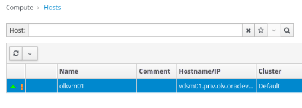

1. After clicking the host's name, the General tab opens with details about the host.

1. Click the Network Interfaces tab on the horizontal menu.

1. The Network Interfaces tab opens with details about the network interfaces on the available host.

1. Click the Setup Host Networks button.

    The Setup Host Networks dialog box opens for the host. The Interfaces column lists any physical interfaces on the host, and the Assigned Logical Networks column displays any logical networks assigned to the interface. The Unassigned Logical Networks column displays the unassigned logical networks.

    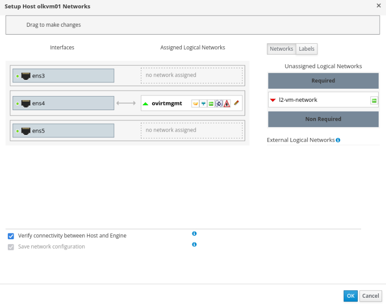

1. Select the `l2-vm-network` from the Unassigned Logical Networks column by left-clicking the network and, while holding down the mouse, drag the network over to the last box to the right to add the network.

    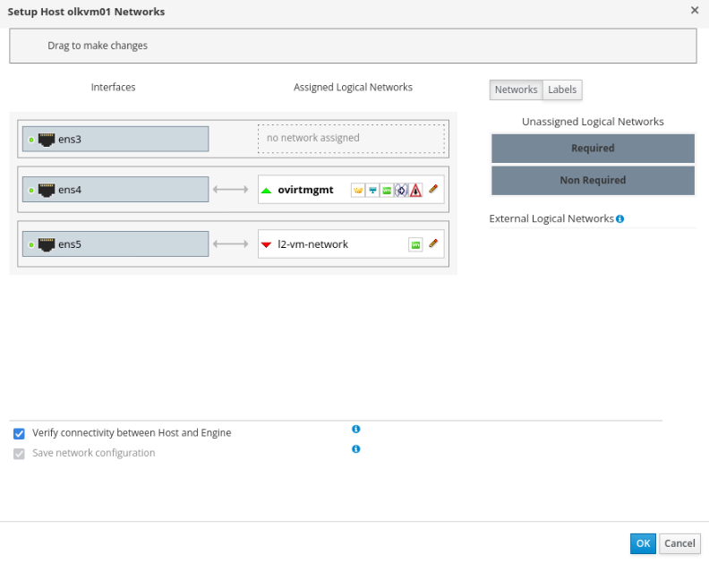

    In the example screenshot, the interface labels the box as the `ens5` network interface. Your environment may differ depending on your configuration.

    **Why is `ens3` unused?**
    > In this Luna lab, `ens3` represents the KVM host’s primary public-side interface. We do not assign OLVM logical networks to it. OLVM management traffic uses `ovirtmgmt` on `ens4`, and VM traffic uses `l2-vm-network` on `ens5`. This keeps public access, host management, and VM traffic separated.


1. Click OK to save the settings and add the network.

    **What just happened:**

    When you drag the logical network to a physical interface and click OK:

    1. **Bridge creation** - VDSM creates a Linux bridge on the host:
      - Bridge name: Based on network name (e.g., `br-l2-vm-network`)
      - Physical interface (ens5) gets attached to the bridge
      - VMs will attach to this bridge for network access

    1. **VLAN configuration** - If VLAN ID is set, interface gets tagged:
      - Creates VLAN interface (e.g., `ens5.100` for VLAN 100)
      - Traffic is tagged with VLAN ID

    1. **Firewall rules** - VDSM updates iptables/firewalld to allow traffic

    1. **Network persistence** - Configuration saved to disk

    **Linux bridge explained:**
    ```
    VM1 (vnet0) ─┐
                 ├─ Bridge (br-l2-vm-network) ─ ens5 ─ Physical Network
    VM2 (vnet1) ─┘
    ```

    - Bridge acts like a virtual switch
    - Each VM gets a virtual interface (vnet0, vnet1, etc.)
    - Virtual interfaces connect to the bridge
    - Bridge connects to physical interface
    - VMs can communicate with each other and external networks


    **Important:** After network changes, don't manually edit `/etc/sysconfig/network-scripts/` - always use OLVM UI or API. Manual changes will be overwritten and can break connectivity.


### Assign a Logical Network to the second KVM Host (olkvm02)

1. Using the side navigation menu, go to Compute and click Hosts.

    The Hosts pane opens.

1. Under the Name column, click the olkvm02 host to add the network.

    

1. After clicking the host's name, the General tab opens with details about the host.

1. Click the Network Interfaces tab on the horizontal menu.

1. The Network Interfaces tab opens with details about the network interfaces on the available host.

1. Click the Setup Host Networks button.

    The Setup Host Networks dialog box opens for the host. The Interfaces column lists any physical interfaces on the host, and the Assigned Logical Networks column displays any logical networks assigned to the interface. The Unassigned Logical Networks column displays the unassigned logical networks.

    

1. Select the `l2-vm-network` from the Unassigned Logical Networks column by left-clicking the network and, while holding down the mouse, drag the network over to the last box to the right to add the network.

    

    In the example screenshot, the interface labels the box as the `ens5` network interface. Your environment may differ depending on your configuration.

1. Click OK to save the settings and add the network.


### Add a Fibre Channel Data Domain

1. Oracle Linux Virtualization Manager uses a centralized storage system for virtual machine disk images, ISO files, and snapshots. In this tutorial, two OCI Block Volumes are attached to the KVM Host and appear as Fibre Channel LUNs.

    **What is a storage domain:**

    A storage domain is a logical entity in OLVM that represents a storage resource where VM disks, templates, ISOs, and snapshots are stored.

    **Types of storage domains:**

    1. **Data Domain** (what we're creating)
      - Stores VM disk images
      - Stores templates
      - Stores snapshots
      - Can have multiple data domains per data center

    1. **ISO Domain**
      - Stores ISO files (installation media)
      - Optional (can upload ISOs to data domain instead)
      - One per data center

    1. **Export Domain**
      - Used for importing/exporting VMs and templates
      - Optional
      - Can be shared between data centers

    **Supported storage types:**

    - **NFS** - Network File System (most common for smaller deployments)
    - **iSCSI** - Block storage over IP networks
    - **Fibre Channel** - High-speed block storage (what we're using)
    - **Local Storage** - Direct-attached disks (no HA or migration)
    - **GlusterFS** - Distributed file system (scalable storage)
    - **POSIX** - Any POSIX-compliant filesystem

    **Why Fibre Channel in this lab:**
    - OCI Block Volumes are attached to the host
    - They appear to the host as Fibre Channel LUNs
    - Provides realistic enterprise storage experience
    - High performance for VM disk I/O

    **LUN = Logical Unit Number:**
    - Each Block Volume appears as a separate LUN
    - LUNs are discovered automatically by OLVM
    - Multiple hosts can access the same LUN (shared storage)

    **Shared storage requirement:**
    - For VM migration and HA, storage must be accessible by all hosts in cluster
    - Fibre Channel and iSCSI provide shared block storage
    - NFS provides shared file storage
    - Local storage does NOT support migration or HA

1. Go back to the OLVM Manager

    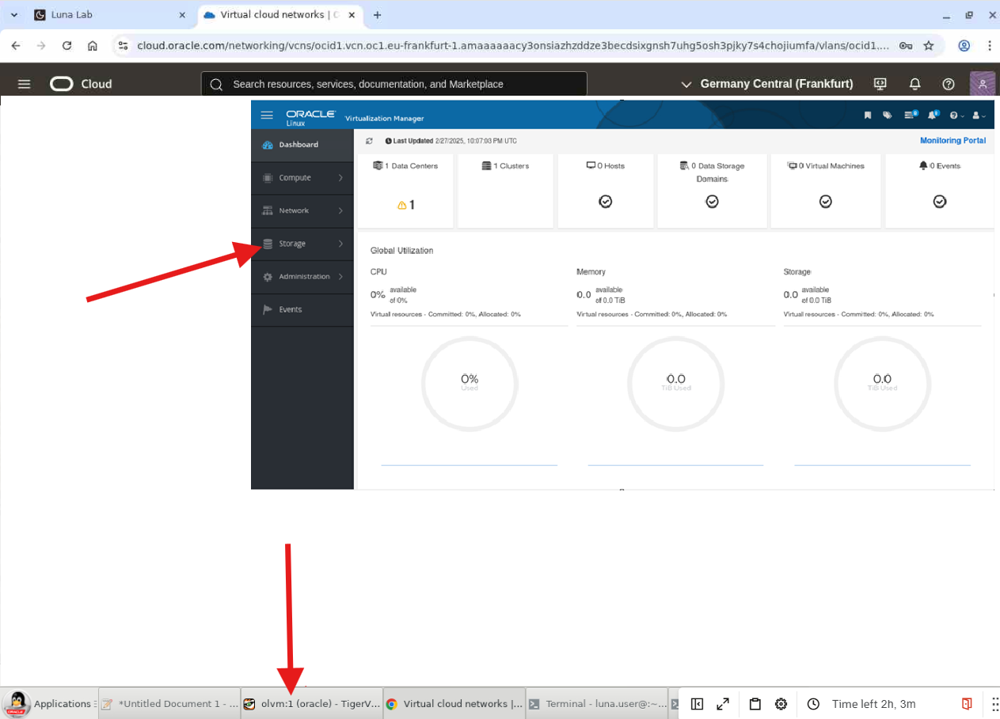

1. Using the side navigation menu, go to Storage and click Domains.

    The Storage Domains pane opens.

1. On the Storage Domains pane, click the New Domain button.

    The New Domain dialog box opens.

1. For the Name field, enter a name for the data domain.
    ```
    amd-storage-domain-01
    ```

1. From the Data Center drop-down list, select the Default option in the drop-down list.

1. From the Domain Function drop-down list, select the Data option in the drop-down list.

1. From the Storage Type drop-down list, select Fibre Channel.

1. For the Host to Use drop-down list, select the olkvm01 host.

1. When selecting Fibre Channel as the Storage Type, the New Domain dialog box automatically displays the known targets with unused LUNs.

1. Click Add next to the first LUN ID.

1. Click OK.

    You can click Tasks in the upper right corner of the UI to monitor the various processing steps that this step completes when attaching the FC data domain to the data center.

1. Wait for the Cross Data Center Status to show as Active before continuing the tutorial.


### Import a Virtual Machine Template

Oracle Linux Virtualization Manager allows the import of existing OVA templates. Oracle provides prebuilt OVA templates from the [Oracle Linux Cloud Images](https://yum.oracle.com/oracle-linux-templates.html) page.

1. Using the side navigation menu, go to Compute and click Templates.

    The Templates pane opens.

1. Click the Import button.

    The Import Template(s) dialog box opens.

1. Keep the default selections for the Data Center, and Source fields.

1. From the Host drop-down list, select `olkvm01`.

1. For the File Path, enter `/tmp`.

    This folder on the olkvm01 host is from where the UI will try to import the OVA template.

    **What is an OVA template:**

    **OVA** = Open Virtualization Archive
    - Industry-standard format for distributing VMs
    - Single file containing:
     - Disk images (usually QCOW2 or VMDK format)
     - VM configuration (CPU, RAM, networks)
     - Metadata (OS type, virtualization settings)

    **Oracle Linux Cloud Images:**
    - Prebuilt, tested VM templates
    - Optimized for cloud/virtualization platforms
    - Include cloud-init for automatic configuration
    - No manual OS installation needed
    - Updated regularly with security patches

    **Template vs VM:**
    - **Template** - Read-only master image
     - Cannot be started directly
     - Used as a base to create VMs
     - Changes to template don't affect existing VMs

    - **VM** - Running instance created from template
     - Has its own disk (thin-provisioned or cloned)
     - Can be started, stopped, modified
     - Independent from the template

    **Import process:**
    1. Download OVA file to host's /tmp directory
    1. OLVM reads OVA metadata
    1. Disk image is uploaded to storage domain
    1. Template is created in OLVM database
    1. Template becomes available for creating VMs

    **Why /tmp:** The import process needs local access to the file. For this lab, we download directly to /tmp for simplicity. In production, you'd typically use an NFS storage domain for template imports.

    **Thin provisioning:** When creating VMs from templates, OLVM uses thin provisioning by default:
    - Template disk is stored once
    - Each VM disk only stores differences from template
    - Saves storage space when you have many VMs from same template

1. Switch to the terminal within the VNC session. Make sure you are on the olvm instance

    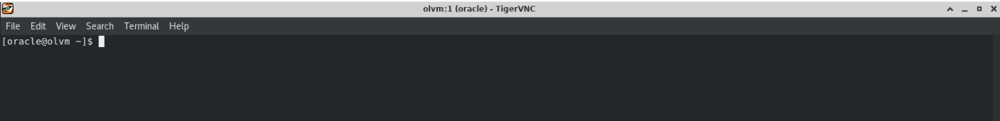

1. Download the OVA template. This command SSHs into olkvm01 and downloads the template there (required because the import reads from the host's filesystem).
    ```bash
    ssh olkvm01 "curl -L https://yum.oracle.com/templates/OracleLinux/OL9/u5/x86_64/OL9U5_x86_64-olvm-b253.ova -o /tmp/ol95.ova"
    ```

1. Switch to the browser within the VNC session.

1. Click the Load button.

    The OVA template appears within the dual list box's Virtual Machines on Source section.

1. Click the OVA template and then the Right Arrow button to send the OVA template to the Virtual Machines to Import side of the dual list box.

    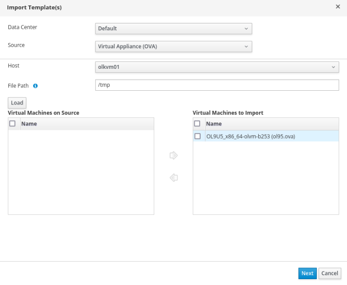

1. Click Next.

1. Review the template information, then click OK.

1. Wait for the status to show as OK.

### Create a Test Virtual Machine from Template

**Note:** This test VM (ol9-vm1) verifies that your networking, storage, and template infrastructure is working correctly.

1. Using the side navigation menu, go to **Compute**
1. Click **Virtual Machines**. The Virtual Machines pane opens.
1. Click the **New** button. The New Virtual Machine dialog box opens.
1. Select the OVA template from the Template drop-down list: **OL9U5x8664-olvm-b253**
1. Select the operating system from the Operating System drop-down list: **Oracle Linux 9.x x64**
1. In the Name field, enter a name for the virtual machine. **ol9-vm1**
1. Select the VM network interface from the nic1 drop-down list: **l2-vm-network**


1. Click the **Show Advanced Options** button. The Advanced Options menu opens. This menu enables setting additional options for the virtual machine, such as a password, SSH key, or static network.
1. Click **Initial Run**.
1. Click **Authentication**.
1. In the **User Name** field, enter a user name to log into the virtual machine: **opc**
1. In the Password and Verify Password fields, enter a password for the user.
1. Click **Networks**.
1. Enter the DNS server IP address in the DNS Servers field: **10.0.10.1**
1. Click the checkbox next to **In-guest Network Interface Name**.
1. Click the **Add** new button.
1. In the **In-guest Network Interface** Name field, enter the name of the network interface: **eth0**
1. From the **IPv4 Boot Protocol** drop-down list, select **Static**. Due to linking the virtual machine network to the OCI VLAN network, there is no default DHCP server to assign IP addresses. This is something we may add later.
1. In the **IPv4 Address** field, enter an IP address in the same range as the OCI VLAN network: **10.0.10.105**
1. In the **IPv4 Netmask** field, enter the network netmask: **255.255.255.0**
1. In the **IPv4 Gateway** field, enter the network gateway: **10.0.10.1**
1. Click **OK**.
1. Wait for the status to change from *Importing* to *Down*.


#### Run the Virtual Machine

1. Select the virtual machine and click the **Run** button.
1. Click the **Console** button down arrow and select **Console Options**.


1. Under **Console Invocation** click **noVNC** and **OK**.


1. Click on **Console**, this will open a new browser window for the VM login
1. From the virtual machine remote viewer, log into the virtual machine using the user name and password you defined.
1. Check the virtual machine network settings: `ip addr`. The output shows the 10.0.10.105  **eth0** network interface using an IP address you entered
1. Ping the network gateway: `ping 10.0.10.1`. The virtual machine successfully pings the gateway.


## Task 4: Application Tier

#### Overview

In this part, you will deploy a complete multi-tier Java web application across your two-host cluster - simply by importing prebuilt OVA (Open Virtual Appliance) files. There is no need to install operating systems, configure databases, or set up application servers manually. Each OVA contains a fully configured, ready-to-run VM exported from another OLVM environment, so the entire application stack comes online in minutes with just a few import steps.

This demonstrates one of OLVM's most powerful capabilities: the ability to package working virtual machines - complete with their OS, software, data, and configuration - and redeploy them on a different OLVM system with minimal effort. What would normally take hours of manual setup is reduced to downloading two files and clicking Import.

The application architecture leverages your existing cluster infrastructure:

- **ol9-mysql** is imported onto olkvm01 and provides a fully configured MySQL 8.0 database, pre-loaded with sample employee data (database tier)
- **ol9-webapp** is imported onto olkvm02 and provides a fully configured Apache Tomcat 9 web server running the Employee Directory Java application (application tier)
- Both VMs communicate across the l2-vm-network - no additional network configuration is required
- The application works seamlessly despite being distributed across separate physical hosts

The application consists of:

- **Database Tier:** MySQL 8.0 running on ol9-mysql VM
- **Application Tier:** Apache Tomcat 9 + Employee Directory web app on ol9-webapp VM

#### Learning Objectives

- Import a pre-configured MySQL database VM (ol9-mysql) from an OVA file onto olkvm01
- Import a pre-configured Java web application VM (ol9-webapp) from an OVA file onto olkvm02
- Verify multi-tier connectivity across the l2-vm-network
- Test distributed application functionality end-to-end

#### What This Demonstrates

- VMs on different hosts communicating seamlessly
- Cluster-based resource distribution
- Real-world application deployment patterns using OVA imports
- OLVM's capability to support production workloads

#### What You Will Build

```
┌────────────────────────────────────────────────────────────────────────┐
│                    Part 4: Application Tier                            │
│                                                                        │
│  Application Architecture:                                             │
│                                                                        │
│  ┌─────────────────────────────────────────────────────────────────┐   │
│  │                         olkvm01                                 │   │
│  │  ┌──────────────────────┐                                       │   │
│  │  │   ol9-mysql VM       │                                       │   │
│  │  │   10.0.10.100        │ ──────────────┐                       │   │
│  │  │                      │               │                       │   │
│  │  │ • MySQL 8.0          │               │                       │   │
│  │  │ • employee_db        │               │                       │   │
│  │  │ • 8 sample records   │               │                       │   │
│  │  └──────────────────────┘               │                       │   │
│  └─────────────────────────────────────────┼───────────────────────┘   │
│                                            │                           │
│                                            │ JDBC                      │
│                                            ▼                           │
│  ┌─────────────────────────────────────────────────────────────────┐   │
│  │                         olkvm02                                 │   │
│  │  ┌──────────────────────┐                                       │   │
│  │  │   ol9-webapp VM      │                                       │   │
│  │  │   10.0.10.101        │                                       │   │
│  │  │                      │                                       │   │
│  │  │ • Apache Tomcat      │                                       │   │
│  │  │ • OpenJDK 17         │                                       │   │
│  │  │ • Employee Directory │                                       │   │
│  │  │   Web App            │                                       │   │
│  │  └──────────────────────┘                                       │   │
│  └─────────────────────────────────────────────────────────────────┘   │
│           │                                                            │
│           │                                                            │
│           ▼                                                            │
│  [Browser Access: http://10.0.10.101:8080/employee-app]                │  
└────────────────────────────────────────────────────────────────────────┘
```

#### Estimated Time

10 - 20 minutes


#### Steps Overview

**Database Tier (ol9-mysql on olkvm01)**

1. Download the ol9-mysql OVA file to olkvm01
1. Import the OVA as a Virtual Machine via the OLVM Administration Portal
1. Assign the l2-vm-network to the VM
1. Start the VM and verify database connectivity

    **Application Tier (ol9-webapp on olkvm02)**

1. Download the ol9-webapp OVA file to olkvm02
1. Import the OVA as a Virtual Machine via the OLVM Administration Portal
1. Assign the l2-vm-network to the VM
1. Start the VM and verify the web application is running
1. Test cross-VM connectivity and access the application in a browser


### Create Virtual Machine 1: ol9-mysql on olkvm01

#### Step 1: Download the OVA File

Open a terminal and connect to the OLVM manager instance. Run the following command to download the ol9-mysql OVA file onto olkvm01:

```bash
ssh olkvm01 "curl -L https://objectstorage.us-ashburn-1.oraclecloud.com/n/idhwewbjlvpy/b/olvm-on-oci/o/ova-e4-shape%2Fol9-mysql.ova -o /tmp/ol9-mysql.ova"
```

#### Step 2: Import the OVA via OLVM Administration Portal

1. Go to the OLVM Administration Portal.
1. Click **Compute → Virtual Machines → Import(3 dots)**.
1. Set Data Center = **Default**.
1. Set Source = **Virtual Appliance (OVA)**.
1. Set Host = **olkvm01**.
1. Set File Path **= /tmp**.
1. Click the **Load** button.
1. Under **Virtual Machines on Source**, click the Name column to select **ol9-mysql.ova**.
1. Use the move arrow to move it to the **Virtual Machines to Import** section.
1. Click **Next**.
1. Click **ol9-mysql**, then click **Network Interfaces**.
1. Select **l2-vm-network** for both Network Name and Profile Name.
1. Click **OK**.
1. Wait for the ol9-mysql VM status to show as **Down**.

#### Step 3: Start and Test the ol9-mysql VM

Select the ol9-mysql VM and click **Run** to start it. Wait for the status to change to **Up**.

From the OLVM manager terminal, SSH into the database VM (username - **opc** password - **oracle** ):

```bash
ssh opc@10.0.10.100
```

Verify MySQL is running and confirm the employee data is present:

```bash
mysql -u empapp -pWelcome#123 employee_db -e "SELECT COUNT(*) as employee_count FROM employees;"
```

You should see a count of 8 employee records.

Exit the database VM:

```bash
exit
```


### Create Virtual Machine 2: ol9-webapp on olkvm02

#### Step 1: Download the OVA File

From the OLVM manager terminal, run the following command to download the ol9-webapp OVA file onto olkvm02:

```bash
ssh olkvm02 "curl -L https://objectstorage.us-ashburn-1.oraclecloud.com/n/idhwewbjlvpy/b/olvm-on-oci/o/ova-e4-shape%2Fol9-webapp.ova -o /tmp/ol9-webapp.ova"
```

#### Step 2: Import the OVA via OLVM Administration Portal

1. Go to the OLVM Administration Portal.
1. Click **Compute → Virtual Machines → Import**.
1. Set Data Center = **Default**.
1. Set Source = **Virtual Appliance (OVA)**.
1. Set Host = **olkvm02**.
1. Set File Path = **/tmp**.
1. Click the **Load** button.
1. Under **Virtual Machines on Source**, click the Name column to select **ol9-webapp.ova**.
1. Use the move arrow to move it to the **Virtual Machines to Import** section.
1. Click **Next**.
1. Click **ol9-webapp**, then click **Network Interfaces**.
1. Select **l2-vm-network** for both Network Name and Profile Name.
1. Click **OK**.
1. Wait for the ol9-webapp VM status to show as **Down**.

#### Step 3: Start and Test the ol9-webapp VM

Select the ol9-webapp VM and click **Run** to start it. Wait for the status to change to **Up**.

From the OLVM manager terminal, SSH into the web application VM (username - **opc** password - **oracle** ):

```bash
ssh opc@10.0.10.101
```

Verify the application is responding:

```bash
curl -s http://localhost:8080/employee-app/ | grep -q "Welcome to Employee Directory" && echo "✓ Application is responding" || echo "✗ Application check failed"
```

Verify connectivity to the MySQL database:

```bash
ping -c 3 10.0.10.100
```

The ping should be successful, confirming that both VMs can communicate over the l2-vm-network.

#### Validation Checklist

Before continuing to Task 5, confirm:

- ✓ `ol9-mysql.ova` downloaded to olkvm01 at `/tmp/`
- ✓ `ol9-mysql` VM imported, network set to `l2-vm-network`, status: Up
- ✓ MySQL employee count returns `8` from `ol9-mysql`
- ✓ `ol9-webapp.ova` downloaded to olkvm02 at `/tmp/`
- ✓ `ol9-webapp` VM imported, network set to `l2-vm-network`, status: Up
- ✓ Web application curl check returns `✓ Application is responding`
- ✓ `ping 10.0.10.100` from `ol9-webapp` successful
- ✓ Employee Directory accessible at `http://10.0.10.101:8080/employee-app/`
- ✓ Employee table displays 8 records


Exit the application VM:

```bash
exit
```

#### Access the Application from OLVM Manager

From the OLVM manager VNC session, open Firefox and navigate to (Wait about 3 minutes ... data may take a while to load):

```
http://10.0.10.101:8080/employee-app/
```

You should see:

- **Home page:** Purple gradient background with "Welcome to Employee Directory" heading
- Click the **"View Employees"** button
- **Employee Directory:** Green table displaying 8 employees with names, emails, departments, and hire dates


## Task 5: VM Live Migration

#### Overview

Live migration allows you to move a running virtual machine from one KVM host to another without downtime. This is a key capability for maintenance operations, load balancing, and high availability scenarios.

**Prerequisites for VM Migration:**

- Both hosts must be in the same cluster
- Both hosts must have access to the shared storage domain
- The destination host must have sufficient resources (CPU, memory)
- The logical network used by the VM must be available on both hosts

**Lab-Specific Prerequisite:** After the extensive infrastructure changes made during this lab (network creation, storage domain attachment, VM provisioning), the engine's internal cache may be out of sync with the current host state. Restart the engine before attempting migration:

```bash
sudo systemctl restart ovirt-engine
```

Wait 2–3 minutes for the engine to fully restart, then refresh the Administration Portal in Firefox before proceeding.

**Why this is needed:** The oVirt engine caches host capabilities, network topology, and storage connectivity in memory. Over a long session with many configuration changes, this cache can become stale - causing a "Could not fetch data needed for VM migrate operation" error. Restarting the engine forces a full re-query of all hosts via VDSM, rebuilding an accurate view of the cluster. This does not affect running VMs, as VDSM on each host manages them independently.

If live migration fails with a UI exception or unexpected migration error, close Firefox completely, reopen it, log back into the Administration Portal, and retry the migration. In long lab sessions, the OLVM web session state can become stale. If the issue persists, restart the engine with `sudo systemctl restart ovirt-engine`, wait 2–3 minutes, refresh the portal, and try again. Running VMs continue to run because VDSM and KVM manage execution on the hosts.

#### Learning Objectives

- Perform live VM migration between hosts in a cluster
- Understand migration prerequisites and verify successful migration

#### Estimated Time

10-15 minutes


#### Verify Migration Prerequisites

1. Switch to the browser within the VNC session.

1. Log in to the Administration Portal.

1. Using the side navigation menu, go to **Compute** and click **Hosts**.

1. Verify both hosts show status **Up**: olkvm01: Up, olkvm02: Up.

1. Using the side navigation menu, go to **Compute** and click **Virtual Machines**.

1. Verify the ol9-mysql VM is running on olkvm01: Check the Host column shows **olkvm01** and the Status column shows **Up** (running).

    **Note:** olkvm02 is already running the ol9-webapp VM. Both hosts have sufficient resources to run multiple VMs simultaneously for the purposes of this lab.

#### Perform Live Migration

1. In the Virtual Machines pane, select the **ol9-mysql** virtual machine by clicking on it.

1. Click the **Migrate** button in the toolbar. The Migrate Virtual Machine(s) dialog box opens.

1. In the Migrate Virtual Machine(s) dialog, select **olkvm02** manually from the Destination Host dropdown. (Alternatively, you can choose "Select destination host automatically" to let OLVM pick the best host based on available resources and scheduling policies.)

1. Click **Migrate** to start the migration.

1. Monitor the migration progress: The VM status will change to **Migrating From**. A progress indicator shows the migration percentage. You can also click on the VM name and view the Events tab for detailed progress.

    **What happens during live migration:**

    ```
    ┌─────────────────┐                    ┌─────────────────┐
    │    olkvm01      │                    │    olkvm02      │
    │   (Source)      │                    │  (Destination)  │
    │                 │                    │                 │
    │  ┌───────────┐  │  1. Memory copy    │  ┌───────────┐  │
    │  │ ol9-mysql │  │ =================> │  │ ol9-mysql │  │
    │  │  (VM)     │  │  2. Dirty pages    │  │  (copy)   │  │
    │  └───────────┘  │ =================> │  └───────────┘  │
    │                 │  3. Final sync     │                 │
    │                 │ =================> │                 │
    │                 │  4. Switch active  │                 │
    └─────────────────┘                    └─────────────────┘
            │                                      │
            └──────────── Shared Storage ──────────┘
                     (amd-storage-domain-01)
    ```

1. **Pre-copy phase:** VM memory is copied to destination while VM continues running
1. **Iterative copy:** Changed (dirty) memory pages are re-copied
1. **Stop-and-copy:** Brief pause to transfer final state
1. **Activation:** VM resumes on destination host

    Wait for the migration to complete (typically 30-60 seconds for this VM).

#### Verify Migration Success

1. In the Virtual Machines pane, verify the ol9-mysql VM now shows: Host: **olkvm02**, Status: **Up**.

1. Click on the ol9-mysql VM name to open the details view.

1. Click the **Events** tab to see the migration history: "VM ol9-mysql started migration on Host olkvm01" and "VM ol9-mysql was migrated to Host olkvm02".

1. Verify the VM is still accessible and functioning. From the olvm engine terminal (via VNC), test connectivity to the migrated VM:

    ```bash
    ping -c 3 10.0.10.100
    ```

    **Note:** You are pinging from the olvm engine, not from inside the VM. This confirms the VM is reachable at the same IP address even though it now runs on a different physical host (olkvm02).

    Verify the database is still accessible:

    ```bash
    ssh opc@10.0.10.100 "mysql -u empapp -pWelcome#123 employee_db -e 'SELECT COUNT(*) FROM employees;'"
    ```

    The output should show 8, confirming the database is operational after migration.

#### Verify from Web Application

From the olvm engine terminal, confirm the web application still connects to the migrated database:

```bash
curl -s http://10.0.10.101:8080/employee-app/employees | grep -c "<tr>"
```

The output should show 9 (1 header + 8 employee rows), confirming end-to-end connectivity.

#### Validation Checklist

Before continuing to Task 6, confirm:

- ✓ Engine restarted before migration attempt
- ✓ Both hosts showing status **Up** before migration
- ✓ `ol9-mysql` live migration initiated from olkvm01 to olkvm02
- ✓ Migration completed - `ol9-mysql` Host column now shows **olkvm02**
- ✓ `ping 10.0.10.100` successful from engine after migration
- ✓ MySQL employee count still returns `8` after migration
- ✓ Web application curl still returns `9` rows after migration


#### Key Concepts to Remember

- **Data Center** = highest level. VMs CANNOT migrate between Data Centers.
- **Cluster** = hosts with same CPU type. Enables live migration and HA.
- You need at least 2 hosts for HA - that's why we have olkvm01 + olkvm02.
- Storage domain MUST be attached before Data Center initializes.
- Cannot mix local and shared storage in the same Data Center.
- **SPM** (Storage Pool Manager) role: only ONE host at a time per Data Center.

**Additional Migration Options:**

| Migration Type | Description | Use Case |
|---------------|-------------|----------|
| Live Migration | VM stays running during move | Production workloads, zero downtime |
| Offline Migration | VM is stopped, then moved | Large VMs, guaranteed consistency |
| Automatic Migration | OLVM moves VMs based on policies | Load balancing, host maintenance mode |

**Tip:** Before performing maintenance on a host, use **Compute → Hosts → [select host] → Management → Maintenance**. OLVM will automatically migrate all VMs to other hosts in the cluster.


## Task 6: Storage Live Migration

#### Overview

In this part, you will add a second Fibre Channel storage domain and move a running VM disk from `amd-storage-domain-01` to `amd-storage-domain-02`.

Storage live migration allows you to move a virtual machine disk from one storage domain to another while the VM remains running. This is useful for storage maintenance, storage balancing, and moving workloads between storage tiers.

#### Goal

Move a running VM disk from:

```text
amd-storage-domain-01
```

to:

```text
amd-storage-domain-02
```

#### Prerequisites

Before starting this section, verify the following:
    - Both KVM hosts, **olkvm01** and **olkvm02**, are Up.
    - The original storage domain, **amd-storage-domain-01**, is **Active**.
    - The VM you plan to test is running.
    - The second unused LUN is available for creating the new storage domain.

#### Add the Second Storage Domain

1. Go to Storage → Domains.
1. Click New Domain.
1. Name the domain:

    ```text
    amd-storage-domain-02
    ```

1. Select:
    - Data Center: Default
    - Domain Function: Data
    - Storage Type: Fibre Channel
    - Host to Use: **olkvm01** or **olkvm02**

1. Select the unused second LUN.
1. Click OK.
1. Wait for the new storage domain to show **Active**.

#### Perform the Disk Move

1. Go to Storage → Domains.
1. Select **amd-storage-domain-01**.
1. Open the Disks tab.
1. From the "Attached To" column,  select VM disk to move **ol9-webapp**.
1. Click **Move**.
1. Select target storage domain:

    ```text
    amd-storage-domain-02
    ```
1. Click OK.
1. Monitor **Tasks/Events** until the move completes.
1. Confirm the VM remains running and reachable.

#### Validate VM Connectivity
From the OLVM manager terminal, SSH into the web application VM (username - **opc** password - **oracle** ):

```bash
ssh opc@10.0.10.101
```

Test for connectivity to ol9-mysql:

```bash
ping -c 3 10.0.10.100
```

#### Validate the Application Path

From the OLVM engine terminal, run:

```bash
curl -s http://10.0.10.101:8080/employee-app/employees | grep -c "<tr>"
```

The expected output is:

```text
9
```

This represents one table header row plus eight employee data rows.

#### Key Concept

Host live migration moves VM execution from one KVM host to another.

Storage live migration moves a VM disk from one storage domain to another.

Both operations can be performed while the VM remains running when the required prerequisites are met.

#### Validation Checklist

Before continuing to Task 7, confirm:

- ✓ `amd-storage-domain-02` added and status: Active
- ✓ Storage live migration initiated from `amd-storage-domain-01` to `amd-storage-domain-02`
- ✓ Migration completed - disk now shows on `amd-storage-domain-02`
- ✓ VM remained running throughout the storage migration
- ✓ `ping 10.0.10.100` successful after storage migration
- ✓ Web application curl returns `9` rows after storage migration

## Task 7: OLVM Engine Backup

#### Overview

In this part, you will create a backup of the OLVM Engine configuration and database using the `engine-backup` command.

Engine backups are important because the OLVM Engine stores the management configuration for data centers, clusters, hosts, storage domains, networks, users, roles, and virtual machines.

#### Create a Manual OLVM Engine Backup

1. From the OLVM engine terminal, run the following command:

    ```bash
    sudo engine-backup --mode=backup --scope=all --file=/tmp/olvm-engine-backup --log=/tmp/olvm-engine-backup.log
    ```

    **What this does:** Creates an OLVM Engine backup file and writes a backup log.

    - **Backup file:** `/tmp/olvm-engine-backup`
    - **Log file:** `/tmp/olvm-engine-backup.log`

1. Verify that the backup file and log file were created.

    ```bash
    ls -lh /tmp/olvm-engine-backup /tmp/olvm-engine-backup.log
    ```

1. Review the last lines of the backup log.

    ```bash
    tail -20 /tmp/olvm-engine-backup.log
    ```

1. In the Administration Portal, open **Events** and confirm that the backup completed successfully.

#### Important

This exercise creates a backup only. Do not run a restore operation unless directed by the instructor.

A restore is normally performed during disaster recovery or engine rebuild scenarios.


#### Create a Scheduled OLVM Engine Backup Script

In this section, you will create a simple backup script and schedule it to run every day at midnight.

1. Create a backup directory.

    ```bash
    sudo mkdir -p /var/lib/ovirt-engine-backup
    ```

1. Create the backup script.

    ```bash
    sudo vi /root/backup.sh
    ```

1. Add the following contents:

    ```bash
    #!/bin/bash

    BACKUP_DIR="/var/lib/ovirt-engine-backup"
    TIMESTAMP=$(/bin/date +%Y%m%d%H%M%S)

    /usr/bin/engine-backup --scope=all --mode=backup \
     --file="${BACKUP_DIR}/backup.${TIMESTAMP}" \
     --log="${BACKUP_DIR}/backup.${TIMESTAMP}.log"
    ```

1. Save and close the file.

1. Make the script executable.

    ```bash
    sudo chmod +x /root/backup.sh
    ```

1. Test the script manually.

    ```bash
    sudo /root/backup.sh
    ```

1. Verify that a backup file and log file were created.

    ```bash
    sudo ls -lh /var/lib/ovirt-engine-backup
    ```

1. Edit the root crontab.

    ```bash
    sudo crontab -e
    ```

1. Add the scheduled backup entry.

    ```cron
    0 0 * * * /root/backup.sh >/dev/null 2>&1
    ```

    This runs the OLVM Engine backup every day at midnight and suppresses normal output and errors.

#### Key Concept

The manual backup command is useful for one-time backups before major changes.

The scheduled backup script is useful for ongoing protection of the OLVM Engine configuration and database.

#### Validation Checklist

Before continuing to Task 8, confirm:

- ✓ Manual backup file created at `/tmp/olvm-engine-backup`
- ✓ Backup log created at `/tmp/olvm-engine-backup.log`
- ✓ `tail -20` of log shows backup completed successfully
- ✓ Backup directory `/var/lib/ovirt-engine-backup` created
- ✓ `backup.sh` script created and made executable
- ✓ Script tested manually - backup file created in backup directory
- ✓ Crontab entry added to run backup at midnight daily

## Task 8: Monitoring Portal / Grafana Walkthrough (Optional)

#### Overview

In this part, you will access the OLVM Monitoring Portal and use the Grafana dashboards to observe real resource activity generated by the VMs and operations you performed earlier in this lab - including OVA imports, live migration, and storage migration.

The Monitoring Portal is not just a passive display. Administrators use it to detect overloaded hosts, identify storage bottlenecks, observe migration impact, and baseline normal behavior before changes.

#### Estimated Time

15–20 minutes


### Access the Monitoring Portal

1. In Firefox inside the VNC session, navigate to the OLVM Engine welcome page:

    ```text
        https://olvm.pub.olv.oraclevcn.com
    ```

1. From the welcome page, click **Monitoring Portal**.

1. To login click on the **"Sign in with oVirt Engine Auth"** link.

    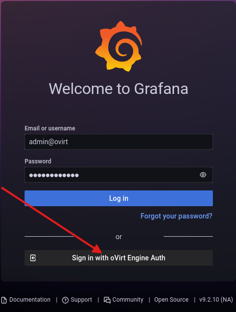

1. In the Grafana home page, from the left navigation menu, click **Dashboards → Browse**

    You will see a list of pre-built OLVM dashboards. These dashboards are populated from data collected by the OLVM data warehouse (`ovirt-engine-dwh`), which continuously records metrics from the engine, hosts, and VMs.


#### Task 1: Identify Which Host Is Under Higher CPU Load

1. In Grafana Browse, type  **Host dashboard** in the search field.

1. Look at the CPU utilization graph for `olkvm01` and `olkvm02`.

    **Questions to answer:**
    - Which host currently shows higher CPU utilization?
    - Is the difference significant, or are the hosts balanced?

1. Record your observation:

    ```text
        Higher CPU host: _______________
        Approximate utilization: _______________
    ```

    **Why this matters:** In a production cluster, you would use this view to decide whether to manually migrate a VM to a less loaded host, or to configure an automatic load-balancing policy on the cluster.


#### Task 2: Observe VM CPU Utilization for ol9-mysql

1. In Grafana Browse, type  **Virtual Machine dashboard** in the search field.

1. Locate the `ol9-mysql` VM in the list.

1. Review the CPU and memory utilization graph for `ol9-mysql`.

    **Questions to answer:**
    - Is the VM currently idle, or showing active CPU usage?
    - What is the approximate memory utilization?

1. Record your observation:

    ```text
        ol9-mysql CPU: _______________
        ol9-mysql Memory: _______________
    ```

    **Why this matters:** Identifying VM-level resource usage helps you right-size VM configurations and detect runaway processes or memory leaks.


#### Task 3: Check Storage Domain Activity

1. In Grafana Browse, type  **Storage Domains Inventory Dashboard** in the search field.

1. Locate the storage domains used in this lab:
    - `amd-storage-domain-01`
    - `amd-storage-domain-02`

1. Review the disk utilization and I/O activity for each domain.

    **Questions to answer:**
    - Which domain shows higher utilization?
    - Is there any residual I/O activity from the storage live migration you performed in Task 6?

    **Why this matters:** Storage domain capacity monitoring is critical in production. A full data domain causes VM pauses and potential data loss.


#### Task 4: Review Engine Health

1. In Grafana Browse, type  **System Dashboard** in the search field.

1. Confirm the following:
    - Engine status: healthy / up
    - Number of hosts: 2
    - Number of VMs running: 3 (ol9-mysql, ol9-webapp, ol9-vm1)
    - Number of active storage domains: 2

    **Why this matters:** The engine health dashboard gives a single-pane summary of the entire cluster. Operators check this dashboard first during an incident.


#### Validation Checklist

Before continuing to Task 9, confirm:

- ✓ You accessed the Monitoring Portal successfully
- ✓ You identified which host has higher CPU utilization
- ✓ You located ol9-mysql in the VM utilization dashboard
- ✓ You confirmed both storage domains are visible and active
- ✓ You reviewed the engine health summary


#### Key Concepts

**OLVM Monitoring Portal** is powered by Grafana and the oVirt Data Warehouse (`ovirt-engine-dwh`). The data warehouse collects historical metrics from the engine and hosts and stores them in a separate PostgreSQL schema. Grafana queries this schema to render dashboards.

**What is tracked:**

- Engine and host uptime and health
- Per-host CPU, memory, and network utilization
- Per-VM CPU, memory, disk I/O, and network
- Storage domain capacity and I/O
- Migration events and durations

**What is NOT in Grafana:**

- Real-time event logs (use **Events** in the Administration Portal)
- Audit history (use **Audit Log** in the Administration Portal)
- Live console access (use **Console** in the VM detail view)


## Task 9: VM Snapshots

#### Overview

In this part, you will create snapshots of virtual machines and learn how OLVM snapshot and restore operations work. A snapshot captures a VM's disk state - and optionally its memory state - at a specific point in time. Snapshots are commonly used before risky changes such as OS patching, application upgrades, or configuration modifications, giving administrators a fast rollback path without needing a full backup restore.

#### Learning Objectives

- Create a VM snapshot from the Administration Portal
- Understand snapshot types: disk-only vs. memory-included
- Understand the snapshot restore workflow: preview → commit / undo
- Identify snapshot storage impact on a storage domain


#### Estimated Time

20–25 minutes

#### What You Will Do

- Create a disk-only snapshot of `ol9-webapp` (running VM)
- Create a disk + memory snapshot of `ol9-mysql` (running VM)
- Inspect snapshot details and storage impact
- Walk through the full restore workflow conceptually
- Understand when snapshots should and should not be used


#### Background: How OLVM Snapshots Work

```text
Before snapshot:
  VM Disk  ──────────────────────────────────────►  Active state

After snapshot:
  Base image (read-only at snapshot point)
       │
       └── Delta disk (COW - captures all writes after snapshot)
                │
                └── Active disk (VM writes go here)
```

**Copy-on-Write (COW):** When a snapshot is created, OLVM does not copy the entire disk. Instead, it marks the current disk state as a read-only base and creates a thin delta layer to capture all future writes. This is fast and space-efficient initially, but delta layers grow as the VM writes data.

**Memory snapshots:** If you include memory (RAM) in the snapshot, OLVM also saves the VM's in-memory state - similar to a "hibernate" point. This allows a full restore to the exact running state, including open connections and application state in RAM. Memory snapshots require pausing the VM briefly during capture.

**Storage impact:** Every snapshot adds a delta disk on the storage domain. Chains of snapshots consume increasing storage and can slow disk I/O. Oracle recommends committing or deleting snapshots that are no longer needed.


### Task 1: Create a Disk-Only Snapshot of ol9-webapp

This creates a snapshot of the web application VM while it is running. Disk-only snapshots do not capture RAM state, making them faster to create and smaller in storage.

1. In the Administration Portal, go to **Compute → Virtual Machines**.

1. Verify `ol9-webapp` shows status **Up**.

1. Click the `ol9-webapp` VM name to open the detail view.

1. Click the **Snapshots** tab in the details pane.

1. Click **Create**.

1. In the **Description** field, enter:

    ```text
        Before application test - disk only
    ```

1. Confirm **Save Memory** is **unchecked** (disk-only snapshot).

1. Confirm the VM disk is listed and selected under the disk list.

1. Click **OK**.

1. Watch the Snapshots tab. The new snapshot will appear with status **In Preview** briefly, then transition to **OK** (represented by a camera icon).

    **Note:** The VM continues running throughout this process. You may briefly see increased storage I/O as the COW layer is initialized.

1. From the OLVM engine terminal, verify the web application is still responding after the snapshot:

    ```bash
        curl -s http://10.0.10.101:8080/employee-app/employees | grep -c "<tr>"
    ```

    Expected output: `9`


#### Task 2: Create a Disk + Memory Snapshot of ol9-mysql

This creates a full snapshot - disk and RAM - of the database VM while it is running.

1. In the Administration Portal, go to **Compute → Virtual Machines**.

1. Click the `ol9-mysql` VM name to open the detail view.

1. Click the **Snapshots** tab.

1. Click **Create**.

1. In the **Description** field, enter:

    ```text
        MySQL running state - disk and memory
    ```

1. Check the **Save Memory** checkbox.

1. Confirm the VM disk is listed and selected.

1. Click **OK**.

    **Note:** Because this snapshot includes memory, you may notice a brief VM pause (typically under 1 second for small VMs). The VM resumes automatically.

1. Wait for the snapshot status to reach **OK**.

1. From the OLVM engine terminal, verify the database is still accessible after the snapshot:

    ```bash
        ssh opc@10.0.10.100 "mysql -u empapp -pWelcome#123 employee_db -e 'SELECT COUNT(*) FROM employees;'"
    ```

    Expected output: `8`


#### Task 3: Inspect Snapshot Details

1. In the Administration Portal, go to **Compute → Virtual Machines**.

1. Click `ol9-webapp` to open the detail view.

1. Click the **Snapshots** tab.

1. Click on the snapshot you created in Task 1 to expand its details.

    Observe the following fields:
    - **Description** - the label you entered
    - **Date** - when the snapshot was taken
    - **Status** - should show `OK`
    - **Memory** - shows `No` for a disk-only snapshot

1. Go to **Storage → Domains** and open `amd-storage-domain-01`. Note that the **Used Space** has increased slightly from the snapshot metadata and initial delta allocation.

    Record your observation:

    ```text
        Snapshot creation time:        _______________
        Snapshot memory included:      Yes / No
        Storage domain used space:     _______________
    ```


#### Task 4: Understand the Restore Workflow (Conceptual - Do Not Execute)

> **Important:** Snapshot restore requires the VM to be in a **Down** (powered off) state. Do **not** perform a restore at this stage. The steps below are for conceptual understanding - practice them when you have a dedicated recovery environment available.

The full OLVM snapshot restore flow is:

**Step 1 - Power off the VM**
```text
Compute → Virtual Machines → [select VM] → Shutdown
Wait for status: Down
```

**Step 2 - Preview the Snapshot**
```text
Compute → Virtual Machines → [select VM] → Snapshots tab
Select the snapshot → Click Preview
```
When you preview a snapshot, OLVM temporarily reverts the VM's disk to the snapshot state. This is reversible - the snapshot status changes to **In Preview**.

**Step 3 - Start and Validate the VM in Preview State**
```text
Click Run - the VM boots from the snapshot disk state
Validate the application, configuration, or OS is in the expected state
```

**Step 4A - Commit (keep the restored state permanently)**
```text
Snapshots tab → Click Commit
```
This permanently discards all changes made after the snapshot. **This action cannot be undone.**

**Step 4B - Undo (discard the restore, return to current state)**
```text
Snapshots tab → Click Undo
```
This discards the preview and returns the VM to its state before the preview was started.

```text
Restore Decision Tree:

Snapshot taken
      │
      ▼
  Power off VM
      │
      ▼
  Preview snapshot
      │
      ├── Looks good? ──► Commit ──► Snapshot becomes permanent active disk
      │
      └── Not right?  ──► Undo   ──► Return to state before preview
```

**Key points to remember:**
- Preview is reversible; Commit is not
- The VM must be **Down** before previewing
- Undo returns to the post-snapshot active state, not a prior snapshot
- Deleting a snapshot merges its delta back into the base disk - this can be time-consuming for large disks


#### Task 5: Delete a Snapshot (Cleanup)

Leaving unnecessary snapshots consumes storage and can degrade disk I/O performance over time as delta chains grow.

1. In the Administration Portal, go to **Compute → Virtual Machines**.

1. Click `ol9-webapp` to open the detail view.

1. Click the **Snapshots** tab.

1. Select the **Before application test - disk only** snapshot.

1. Click **Delete**.

1. Confirm the deletion when prompted.

1. Wait for the snapshot to disappear from the Snapshots tab.

    **What happens during deletion:** OLVM merges the delta disk back into the base image. For a lightly-used VM this is fast. For a VM with a large delta, this merge can take several minutes and generates elevated storage I/O.

    **Note:** The `MySQL running state - disk and memory` snapshot on `ol9-mysql` can remain for reference.


#### Validation Checklist

Before continuing to Task 10, confirm:

- ✓ Disk-only snapshot created on `ol9-webapp` - status: OK
- ✓ Disk + memory snapshot created on `ol9-mysql` - status: OK
- ✓ Web application verified responsive after snapshot (curl returned 9)
- ✓ Database verified accessible after snapshot (count returned 8)
- ✓ Restore workflow (Preview → Commit / Undo) understood conceptually
- ✓ Disk-only snapshot on `ol9-webapp` deleted successfully


#### Key Concepts Summary

| Concept | Detail |
|---------|--------|
| Snapshot type: disk only | Fast, smaller; does not capture RAM state |
| Snapshot type: disk + memory | Captures RAM; brief VM pause; full state restore |
| COW (Copy-on-Write) | Delta layer captures post-snapshot writes; grows over time |
| Preview | Temporarily reverts to snapshot; reversible |
| Commit | Permanently replaces active disk with snapshot state |
| Undo | Discards preview; returns to post-snapshot active state |
| Delete snapshot | Merges delta into base; I/O-intensive for large disks |
| VM state required for restore | VM must be **Down** before previewing |

## Task 10: Manage Users and Roles

#### Overview

In this part, you will create and manage users in Oracle Linux Virtualization Manager (OLVM) 4.5.

OLVM 4.5 supports more than one user source. Users similar to the default portal administrator (`admin@ovirt`) are created through the integrated Keycloak service. OLVM also supports local internal users, which are created on the engine host with `ovirt-aaa-jdbc-tool`.


#### What You Will Build:

- Create a new user in the Keycloak `ovirt-internal` realm
- Import the Keycloak user into OLVM
- Assign the `SuperUser` role to the Keycloak user
- Create a local internal user with `ovirt-aaa-jdbc-tool`
- Import the local user into OLVM
- Assign a role to the local user
- Understand the difference between Keycloak-backed users and local internal users


#### Create a Keycloak-Backed Administrative User

1. Open Firefox from the OLVM manager desktop.

1. Navigate to the Keycloak Administration Console:

    ```text
    https://<olvm-fqdn>/ovirt-engine-auth/admin
    ```

    Example:

    ```text
    https://olvm.pub.olv.oraclevcn.com/ovirt-engine-auth/admin
    ```

1. Log in using the Keycloak administrative account:

    - **Username:** `admin`
    - **Password:** *(the password configured during `engine-setup`)*

1. Confirm that the selected realm is: **ovirt-internal**.

1. In the left navigation menu, click **Users**.

1. Click **Add user**.

1. Enter values similar to the following:

    | Field | Value |
    |---|---|
    | Username | `newadmin` |
    | Email | *(optional)* |
    | First name | `New` |
    | Last name | `Admin` |
    | Enabled | On |

1. Click **Save**.

#### Set the Keycloak User Password

1. With the new user selected, click the **Credentials** tab.

1. Enter a password for the new user.

1. Set **Temporary** to **Off**.

1. Click **Set Password**.

1. Confirm the password reset when prompted.

#### Import the Keycloak User into OLVM

1. Return to the **OLVM Administration Portal**.

1. Log in as:

    ```text
    admin@ovirt
    ```

1. Go to **Administration** → **Users**.

1. Under **Search** select **internalsso (internalkeycloak-authz)**

1. Click **Add**.

1. In the search field, enter the username you created in Keycloak:

    ```text
    newadmin
    ```

1. Click **Go**.

1. Select the user from the results and click **Add**.

    > **Troubleshooting Tip:** If the user does not appear, verify that the account was created in the `Ovirt-internal` Keycloak realm and that you are searching the correct authorization provider.

#### Assign the SuperUser Role to the Keycloak User

1. In **Administration** → **Users**, select the newly added user.

1. In the details pane, click the **Permissions** tab.

1. Click **Add System Permission**.

1. Select the following role:

    ```text
    SuperUser
    ```

1. Click **OK**.

### Create a Local Internal User

To create a local internal user in OLVM 4.5, use the `ovirt-aaa-jdbc-tool` on the engine host.

1. Connect to the OLVM engine host using SSH.

1. Create the user account.

    ```bash
    sudo ovirt-aaa-jdbc-tool user add test1 --attribute=firstName=John --attribute=lastName=Doe
    ```

    The `--attribute` flags are optional, but they are recommended because they make the user easier to identify in the Administration Portal.

#### Set the Local User Password


1. Run the following command on the engine host:

    ```bash
    sudo ovirt-aaa-jdbc-tool user password-reset test1 --password-valid-to="2035-12-31 23:59:59+0000"
    ```

1. Enter and confirm the password when prompted.

#### Add the Local User to the Administration Portal

Even after the local user is created, the account will not appear in the Administration Portal until you manually add it.

1. Log in to the OLVM Administration Portal as an administrator.

1. Go to **Administration** → **Users**.

1. Click **Add**.

1. In the search field, type the name of the user you just created.

1. Click **Go**.

1. Select the user from the results and click **Add**.

#### Assign a Role to the Local User

Once added to the portal, you must assign a role.

1. Select the local user in the **Users** pane.

1. Click the **Permissions** tab in the details section.

1. Click **Add System Permission**.

1. Select a role such as:

    - `UserRole` for VM Portal access
    - `SuperUser` for full administrative rights

1. Click **OK**.


### Verify User Access

1. Log out of the OLVM Administration Portal.

1. Log in using the new Keycloak-backed administrative user and verify full access.

1. Confirm that the local internal user appears in **Administration** → **Users**.

1. Verify that the local internal user has the expected role assigned in the **Permissions** tab.

#### **Important:**

>1.  In OLVM 4.5, users created with `ovirt-aaa-jdbc-tool` are local internal users. They are different from Keycloak-backed users such as `admin@ovirt`.
>1. In a Keycloak-enabled OLVM 4.5 environment, a local internal user created with `ovirt-aaa-jdbc-tool` may not be usable for normal web portal login. For browser-based administrative access, use a Keycloak-backed user.


#### Key Concepts

- **Keycloak-backed users** are used for users similar to `admin@ovirt`.
- **Local internal users** are created with `ovirt-aaa-jdbc-tool`.
- Both types of users must be added to OLVM and assigned roles before they can be used effectively.
- A user without permissions can authenticate but may not have usable access in the portal.


#### At this point, you should have:

- A new Keycloak-backed administrative user
- The `SuperUser` role assigned to that user
- A local internal user created with `ovirt-aaa-jdbc-tool`
- A role assigned to the local user
- Verified login and access for both user types


#### Validation Checklist

Confirm the following before completing the lab:

- ✓ Keycloak user `newadmin` created in the `ovirt-internal` realm
- ✓ Password set and Temporary set to **Off**
- ✓ `newadmin` imported into OLVM Administration Portal
- ✓ `SuperUser` role assigned to `newadmin`
- ✓ Local user `test1` created with `ovirt-aaa-jdbc-tool`
- ✓ Password set for `test1` with future expiry date
- ✓ `test1` imported into OLVM Administration Portal
- ✓ Role assigned to `test1`
- ✓ Logged in successfully with the Keycloak-backed user
- ✓ `test1` visible in **Administration → Users** with correct role


## Appendix 1: Quick Reference - Essential OLVM Commands

### Overview

This section provides a condensed reference of the most important commands and procedures used throughout the lab. Use this as a quick lookup guide during the lab or as a reference after completing it.

### Installation & Engine Setup

```bash
# Enable OLVM repositories
sudo dnf install -y oracle-ovirt-release-45-el8

# Install UEK extra kernel modules
sudo dnf install -y kernel-uek-modules-extra

# Reboot after installing kernel modules
sudo reboot

# Run OLVM pre-check
olvm-pre-check.py

# Install engine
sudo dnf install -y ovirt-engine

# Configure engine (will prompt for admin password)
sudo engine-setup --accept-defaults

# Access portal
# https://<fqdn>/ovirt-engine
```

### Host & Cluster Management

```bash
# Connect to KVM hosts from the OLVM engine
ssh olkvm01
ssh olkvm02

# Get engine SSH public key (for adding hosts)
ssh-keygen -y -f /etc/pki/ovirt-engine/keys/engine_id_rsa

# Copy engine public key to a KVM host
sudo ssh-keygen -y -f /etc/pki/ovirt-engine/keys/engine_id_rsa | ssh olkvm01 -T "sudo tee -a /root/.ssh/authorized_keys"

# Verify VDSM service on host
sudo systemctl status vdsm

# Disable SELinux temporarily, if directed during troubleshooting
sudo setenforce 0
```

### VM Access and Connectivity

```bash
# Connect to VMs directly from olvm engine
ssh opc@10.0.10.100  # MySQL VM
ssh opc@10.0.10.101  # Webapp VM

# Test connectivity
ping 10.0.10.1
ping 8.8.8.8

# Check VM network configuration
ip addr show eth0
```

### Networking & VM Operations

- Create logical network: **Network → Networks → New**
- Import template: **Compute → Templates → Import**
- Import OVA VM: **Compute → Virtual Machines → Import**
- Test connectivity: `ping 10.0.10.1` or `ping 8.8.8.8`

### Advanced UI Operations

- Storage live migration: **Storage → Domains → [domain] → Disks → Move**
- Monitoring Portal: OLVM welcome page → **Monitoring Portal**
- VM snapshot: **Compute → Virtual Machines → [VM] → Snapshots → Create**

### Engine Backup

```bash
# Manual engine backup
sudo engine-backup --mode=backup --scope=all --file=/tmp/olvm-engine-backup --log=/tmp/olvm-engine-backup.log

# Verify backup output
ls -lh /tmp/olvm-engine-backup /tmp/olvm-engine-backup.log
tail -20 /tmp/olvm-engine-backup.log
```

### Troubleshooting

```bash
# Check logs
sudo tail -50 /var/log/ovirt-engine/engine.log
sudo tail -50 /var/log/vdsm/vdsm.log

# Check service status
sudo systemctl status vdsm
sudo systemctl status ovirt-engine

# Check connectivity
ip addr show eth0
sudo ss -tlnp | grep 8080
```

### Stale browser session troubleshooting

1. First try closing and reopening Firefox.
1. Log back into the Administration Portal.
1. Retry migration.
1. If migration still fails with “Could not fetch data needed for VM migrate operation,” restart the engine:

    ```bash
    sudo systemctl restart ovirt-engine
    ```

## Next Steps

### Where to Go Next

| Goal | Recommended Actions |
|------|-------------------|
| Deeper OLVM Skills | Explore cloning, HA configurations, backup restore, and disaster recovery |
| Automation | Learn Ansible for OLVM, explore CI/CD integration |
| Learn More | Explore Oracle Linux Virtualization Manager official documentation |

### Explore Additional Features

- Clone VMs to create additional web servers
- Practice VM migration and storage migration with different workloads
- Monitor resource usage over time in the Monitoring Portal
- Set up high availability configurations
- Practice full backup and restore procedures in a dedicated recovery environment
- Explore automation with Ansible

### Learn More

- Explore Oracle Linux Virtualization Manager documentation
- Practice backup and recovery procedures
- Study container technologies and migration paths
- Explore automation with Ansible


## Conclusion

Congratulations on completing this comprehensive OLVM base and advanced administration lab! You have successfully:

- ✓ Deployed a complete OLVM virtualization platform
- ✓ Configured KVM hosts in a cluster
- ✓ Set up networking and storage for virtual machines
- ✓ Created and managed virtual machines
- ✓ Imported a multi-tier application using OVA files
- ✓ Performed live VM migration between hosts
- ✓ Added a second storage domain
- ✓ Performed storage live migration
- ✓ Created an OLVM Engine backup
- ✓ Reviewed Monitoring Portal / Grafana dashboards
- ✓ Created a VM snapshot
- ✓ Created and imported users
- ✓ Assigned OLVM roles and permissions

### Key Achievements

- Built practical OLVM installation, configuration, and administration skills
- Practiced VM lifecycle, networking, storage, backup, monitoring, and migration workflows
- Gained hands-on experience with core and advanced OLVM administration tasks
- Demonstrated real-world virtualization platform capabilities

### Remember

The Luna lab environment expires after your session - no cleanup is needed as the environment is automatically deprovisioned. Make sure to:

- Note down key learnings and configurations
- Take screenshots of important setups

Thank you for completing this lab - you now have hands-on experience building and managing a complete Oracle Linux Virtualization Manager environment!

*This lab is for learning, testing, and evaluation purposes. For production deployments, consult Oracle's official documentation and best practices guides.*

## Acknowledgements

- **Author** - Shawn Kelley, John Priest, Perside Foster
- **Contributor** - Marvin Kim
- **Last Updated By/Date** - Perside Foster, October 9, 2026
