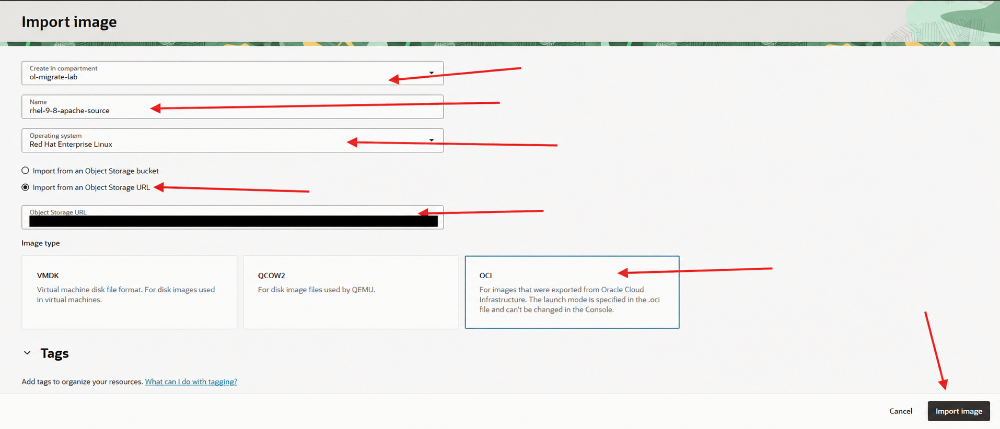
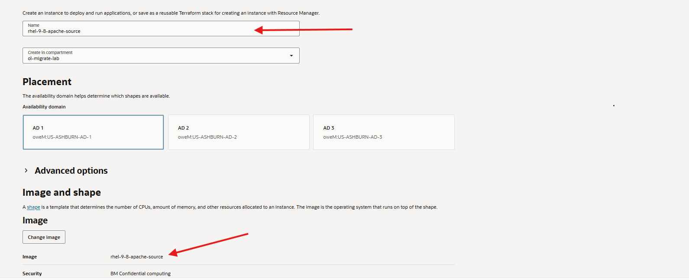
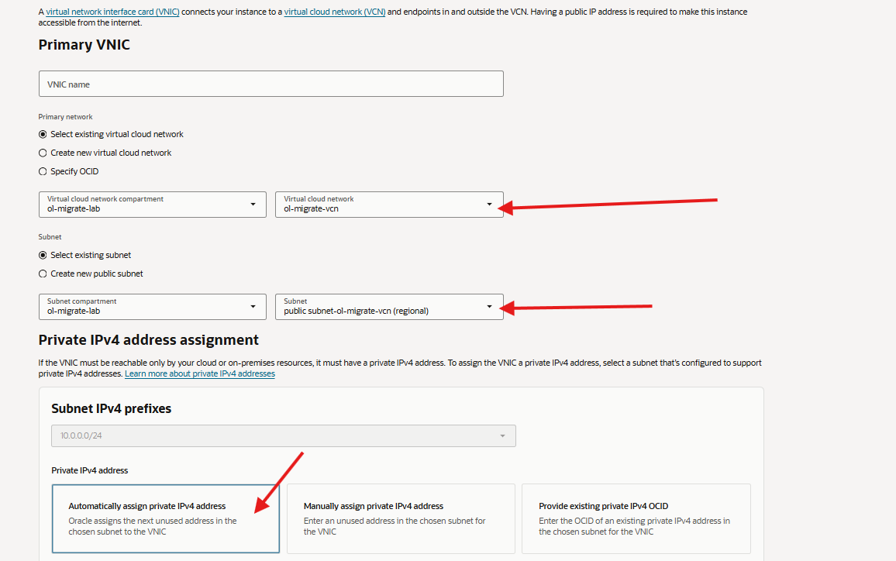
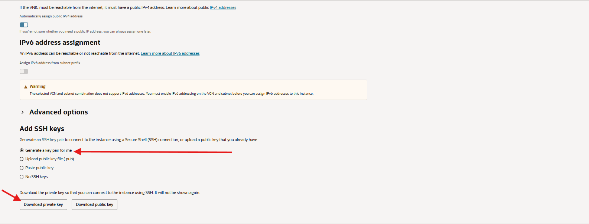
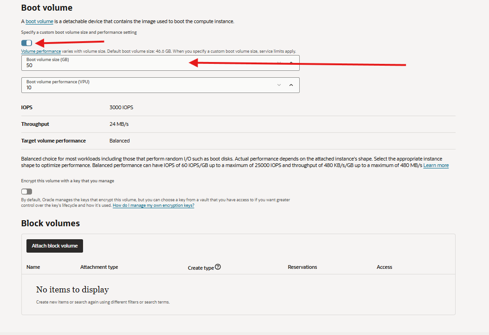
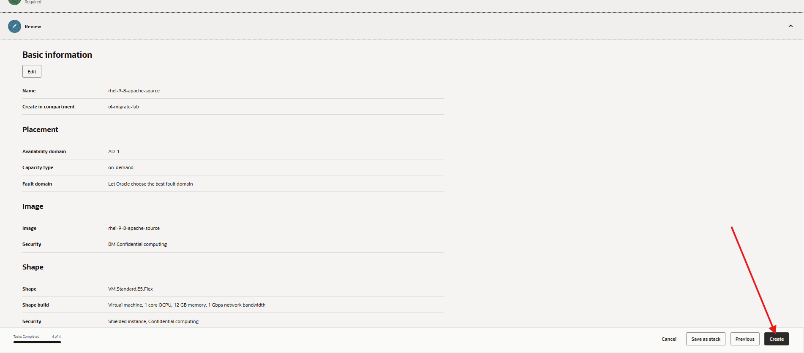

# Lab 1: Build and Verify the Migration Environment

## Introduction

Start the student workshop here. Your instructor supplies a prepared RHEL 9.8 image with Apache installed and Red Hat registration removed. You create your own destination network, import the image, launch a VM, and verify the application. All environment setup needed by students is included in this lab.

### Objectives

- Select a destination compartment and create a VCN with internet connectivity.
- Restrict SSH and HTTP access to your client IP address.
- Import the instructor-provided image and launch the destination VM.
- Verify RHEL 9.8, Apache, the HTML application, and registration cleanup.

Estimated Lab Time: 45 minutes

### Prerequisites

- Access to an OCI tenancy and a region with capacity for `VM.Standard.E5.Flex` or an instructor-tested x86_64 alternative.
- Permission to create networking, import custom images, and launch a Compute instance in an assigned compartment. If you must create a compartment, you also need that permission.
- A valid object-read PAR URL for the prepared `rhel-9-8-apache-source` OCI export, supplied privately by your instructor.
- A browser, an SSH client, and an SSH key pair, or permission to generate a key pair in the instance wizard.
- Quota for 1 OCPU, at least 8 GB of memory, and a boot volume of at least 50 GB or the image minimum.

No Red Hat account, local RHEL download, Object Storage bucket, or image-preparation work is required from students. If the image URL is missing or expired, ask your instructor for a valid URL before continuing.

## Task 1: Confirm access and select the destination compartment

1. Sign in to the [OCI Console](https://cloud.oracle.com/) and select the destination region assigned by your instructor. Record it; create all resources in this lab in that region.

2. Select your assigned compartment. Each student should use a separate compartment, or a unique resource-name suffix agreed with the instructor when sharing a compartment.

3. If no compartment was assigned and you have permission to create one, open **Identity & Security**, then **Compartments**, and select **Create compartment**. Use `ol-migrate-lab` as the name and select the parent compartment permitted by your organization. Wait until it is available. Otherwise, ask the instructor to assign a compartment.

4. Confirm that you can create a VCN, import a custom image, and launch a Compute instance in the selected compartment. Confirm that your instructor-provided PAR URL covers the planned image import. Keep the URL private.

5. Determine your current public client IPv4 address using an organization-approved method. Record it as `<your-public-ip>/32`; use this source for SSH and HTTP access. If your client IP changes during the workshop, update those access rules.

## Task 2: Create the VCN and restrict access

1. Open **Networking**, then **Virtual cloud networks**, and select your destination compartment.

2. Select **Start VCN Wizard**, either directly or under **Actions**. Choose **Create VCN with Internet Connectivity** and start the wizard.

3. Enter the following values, or the non-overlapping CIDRs and names assigned by your instructor:

    - VCN name: `ol-migrate-vcn`
    - VCN IPv4 CIDR: `10.20.0.0/16`
    - Public subnet IPv4 CIDR: `10.20.10.0/24`
    - Private subnet IPv4 CIDR: `10.20.20.0/24`

    Leave IPv6 disabled for this workshop. The VM will use the public subnet; the private subnet is not used by these exercises.

4. Review the wizard summary and create the VCN. Wait for creation to finish, then open the VCN.

5. Open the public subnet and check its route table. Confirm that `0.0.0.0/0` routes to the VCN's enabled internet gateway. Confirm that the subnet permits public IPv4 addresses and has outbound access for DNS, HTTPS, and package downloads.

6. In the VCN, open **Network security groups** and create `ol-migrate-nsg` in your destination compartment.

7. Add the following stateful ingress rules to the network security group. Set the source type to **CIDR**, protocol to **TCP**, source port to **All**, and destination port as shown:

    | Source CIDR | Destination port | Purpose |
    | --- | --- | --- |
    | `<your-public-ip>/32` | 22 | SSH from your computer |
    | `<your-public-ip>/32` | 80 | HTTP from your browser |

8. Open the public subnet's associated security lists and inspect their ingress rules. For this newly created workshop network, restrict any rule that permits SSH or HTTP from a broader source to `<your-public-ip>/32`. Keep the existing ICMP rules and outbound rules. Do not change shared network rules without the instructor's direction.

    Security lists and network security groups both allow traffic. A restricted NSG does not override a broader security-list rule. Do not leave SSH open to `0.0.0.0/0`.

9. Record the VCN, public subnet, and NSG names. Confirm that the public subnet has its internet route and outbound access, and that SSH and HTTP ingress are restricted to your client IP. You will attach this NSG when launching the VM in Task 4.

## Task 3: Import the instructor-provided image

1. Confirm that the destination region and compartment selected in Task 1 are still selected.

2. Open **Compute**, then **Custom images**, and select **Import image**.

3. Enter `rhel-9-8-apache-source` as the image name.

4. Select **Red Hat Enterprise Linux** if offered, or **Linux** in a Console layout with generic operating-system choices.

5. Choose **Import from an Object Storage URL** and paste the complete PAR URL supplied privately by your instructor.

    Keep the PAR URL private and hide it in any screenshots you share.

6. Select **OCI** as the image type. The launch mode is selected from the exported metadata automatically.

    

7. Select **Import image** and wait until its state is Available. If it fails, inspect the work request and confirm that the PAR permits reads and has not expired.

## Task 4: Launch and verify the destination instance

1. Open the destination `rhel-9-8-apache-source` image and confirm that `VM.Standard.E5.Flex` is listed under compatible shapes. Add the tested shape if needed.

2. Select **Create instance** and enter `ol-migrate-rhel-source` as the instance name.

    The wizard may initially use the image name, `rhel-9-8-apache-source`, as the instance name. Replace it with `ol-migrate-rhel-source`; keep the selected image unchanged.

3. Under **Basic information**, select an availability domain and confirm that the selected image is `rhel-9-8-apache-source`. Select `VM.Standard.E5.Flex` and configure 1 OCPU and at least 8 GB of memory. A 12 GB configuration is also sufficient.

    The example shows the wizard's default instance name. Use `ol-migrate-rhel-source` for your instance.

    

4. Under **Networking**, select the VCN and public subnet created in Task 2. Keep automatic private IPv4 assignment and attach `ol-migrate-nsg`, the SSH/HTTP network security group created in Task 2.

    The example uses a different subnet CIDR. Select the public subnet you created; your assigned CIDR may differ from the screenshot.

    

5. Enable **Automatically assign public IPv4 address** and leave IPv6 disabled for this workshop. Under **Add SSH keys**, upload or paste your SSH public key. If you select **Generate a key pair for me**, download and securely save the private key before continuing; it will not be shown again.

    

6. Under **Storage**, enable **Specify a custom volume size and performance setting**. Set the boot volume to at least 50 GB or the image minimum, whichever is larger.

    

7. Under **Review**, confirm the instance name, selected image, shape, memory, networking, and SSH key. If the name still matches the image name shown in the example, select **Edit** and change it to `ol-migrate-rhel-source`. Select **Create**.

    

8. Wait until the instance is Running and record its public IP. Connect from your local terminal:

    ```bash
    <copy>
    ssh -i <private-key-path> cloud-user@<public-ip>
    </copy>
    ```

9. Verify the operating system and application:

    ```bash
    <copy>
    cat /etc/os-release
    systemctl is-enabled httpd
    systemctl is-active httpd
    curl --fail --silent http://127.0.0.1/ | grep MIGRATION_WORKLOAD_OK
    </copy>
    ```

    Expected results are RHEL 9.8, `enabled`, `active`, and the workload marker.

10. Verify registration cleanup:

    ```bash
    <copy>
    sudo find /etc/pki/consumer /etc/pki/entitlement \
      -type f -name '*.pem' -print 2>/dev/null
    sudo grep '^enabled=' \
      /etc/dnf/plugins/subscription-manager.conf \
      /etc/dnf/plugins/product-id.conf
    </copy>
    ```

    No registration certificate files should be listed, and both plugins must show `enabled=0`. The login banner suggesting `rhc connect` is not proof of registration. Do not run that command.

11. Open `http://<public-ip>/` in your browser and confirm that the HTML page displays `MIGRATION_WORKLOAD_OK`.

12. Continue to Lab 2, the Linux Command-Line Quickstart, on this destination instance. Assess migration readiness afterward in Lab 3. Do not repeat the preparation registration or package installation steps.

## Learn More

- [Create a VCN with Internet Connectivity](https://docs.oracle.com/en-us/iaas/Content/Network/Tasks/quickstartnetworking.htm)
- [OCI security rules](https://docs.oracle.com/en-us/iaas/Content/Network/Concepts/securityrules.htm)
- [Importing a custom image](https://docs.oracle.com/en-us/iaas/Content/Compute/Tasks/custom-images-import.htm)
- [Creating an OCI Compute instance](https://docs.oracle.com/en-us/iaas/Content/Compute/Tasks/launchinginstance.htm)
- [Connecting to a Linux instance](https://docs.oracle.com/en-us/iaas/Content/Compute/Tasks/connect-to-linux-instance.htm)

## Acknowledgements

- **Author** - Perside Foster, Principal Solution Engineer, Oracle
- **Last Updated By/Date** - Oracle LiveLabs Workshop Team, October 2026
