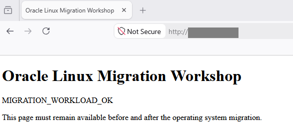

# Lab 4: Migrate to Oracle Linux

## Introduction

After completing the readiness checks and dry run in Lab 3, convert the RHEL VM to Oracle Linux 9.8. The script replaces distribution release packages, configures Oracle repositories, replaces packages with Oracle builds, installs Oracle Linux RHCK, and writes migration reports.

The VM remains the same OCI instance. Its operating-system identity, repositories, packages, and kernel change.

### Objectives

In this lab, you will:

- Execute a same-major-version in-place migration.
- Review package and repository changes.
- Reboot into an Oracle Linux RHCK.
- Confirm that SSH and the workload survived the conversion.

Estimated Lab Time: 40 minutes

## Task 1: Execute the migration

1. Start the migration to Oracle Linux 9.8 and select RHCK:

    ```bash
    <copy>
    cd "$HOME/ol-migration"
    sudo ./migrate-to-oracle-linux.sh \
      -y \
      --target-version 9.8 \
      --kernel rhck
    </copy>
    ```

    The operation changes repositories, distribution packages, and the installed kernel. Do not close the SSH session while the command is running.

2. Follow the migration output. The [script documentation](https://github.com/oracle/migrate-to-ol/blob/main/README-migrate-to-oracle-linux.md) describes the main operations:

    - Check the source, target, RPM database, and running kernel.
    - Record the starting OS, repositories, and installed packages.
    - Configure Oracle repositories and replace the distribution release packages.
    - Replace packages with Oracle builds. This same-release migration uses exact package matches where available and nearest-release replacements where needed.
    - Install the selected RHCK kernel, set the boot default, and write the final reports.

    This workshop uses the script version verified in Lab 3. The current repository documentation can describe newer versions.

3. Check the completion result. Continue only after the script reports `Migration completed.` If it reports an error, keep the displayed log path and review it with the instructor before retrying. The documentation explains the migration modes and report files; use the log from your run to identify the failed operation.

4. At successful completion, record the run directory and log file.

    When the script displays `Reboot into Oracle Linux when ready:`, first complete Task 2 below. Reboot in Task 3.

## Task 2: Inspect the converted system before reboot

1. Verify that the installed user space identifies as Oracle Linux:

    ```bash
    <copy>
    cat /etc/os-release
    rpm -q oraclelinux-release oraclelinux-release-el9
    </copy>
    ```

2. Verify Oracle repositories:

    ```bash
    <copy>
    sudo dnf repolist --enabled
    </copy>
    ```

3. Inspect installed Oracle Linux kernel packages and the default kernel:

    ```bash
    <copy>
    rpm -qa 'kernel*' | sort
    sudo grubby --default-kernel
    </copy>
    ```

    The selected Oracle RHCK build may differ from the source RHEL kernel, including a lower release suffix. Verify that it is installed and selected for boot; the running kernel is checked after reboot.

4. Review the migration reports. Set `RUN_DIR` to the **State** path printed by the completed migration, replacing `<run-id>` with your actual run ID. Use the migration run rather than the earlier dry run:

    ```bash
    <copy>
    RUN_DIR="/var/lib/migrate-to-oracle-linux/<run-id>"
    sudo ls -1 "$RUN_DIR"
    </copy>
    ```

    The [Reports section of the script documentation](https://github.com/oracle/migrate-to-ol/blob/main/README-migrate-to-oracle-linux.md) explains the report files. Review the HTML reports listed at completion with your instructor:

    | Report | What to review |
    | --- | --- |
    | `migration-rpm-map.html` | The package migration results and exceptions. |
    | `reinstalled-oracle-exact.html` | Packages reinstalled with exact Oracle matches. |
    | `reinstalled-oracle-nearest.html` | Packages replaced with a different Oracle release. |
    | `not-reinstalled-oracle.html` | Packages that were not reinstalled from Oracle repositories. |

    Review version changes and any retained source-vendor packages needed by your application. A dry-run unavailable-package list is a plan; it does not establish which packages remain installed after migration. Warnings need review, but do not automatically mean the conversion failed. Ask the instructor to resolve unfamiliar exceptions before continuing.

## Task 3: Reboot into Oracle Linux RHCK

1. Reboot the VM:

    ```bash
    <copy>
    sudo reboot
    </copy>
    ```

2. Wait for the VM to finish rebooting and accept SSH connections again. A Running status alone does not prove SSH is ready.

3. Reconnect using the same public IP, SSH private key, and `cloud-user` account:

    ```bash
    <copy>
    ssh -i <private-key-path> cloud-user@<public-ip>
    </copy>
    ```

4. Confirm the operating system and running kernel:

    ```bash
    <copy>
    cat /etc/os-release
    uname -r
    rpm -qf "/boot/vmlinuz-$(uname -r)" --qf '%{NAME} %{VERSION}-%{RELEASE} %{VENDOR}\n'
    </copy>
    ```

    Expected results:

    - `ID="ol"`
    - `VERSION_ID="9.8"`
    - The running kernel package vendor identifies Oracle.
    - The kernel name does not contain `uek` on the core RHCK path.

    The exact kernel build can vary. The vendor and RHCK checks establish the selected boot path; do not require the pre-migration kernel version string to stay unchanged.

5. Open `http://<public-ip>/` in your browser and confirm the page still displays `MIGRATION_WORKLOAD_OK`.

    

    If the page is unavailable, keep the migration log and ask the instructor to investigate before continuing.

## Learn More

- [Migration script documentation](https://github.com/oracle/migrate-to-ol/blob/main/README-migrate-to-oracle-linux.md)
- [Managing kernels and system boot on Oracle Linux](https://docs.oracle.com/en-us/iaas/oracle-linux/boot/boot-about-system-boot-kernels.htm)
- [Oracle Linux 9 package repositories](https://yum.oracle.com/oracle-linux-9.html)

## Acknowledgements

- **Author** - Perside Foster, Principal Solution Engineer, Oracle
- **Last Updated By/Date** - Oracle LiveLabs Workshop Team, October 2026
